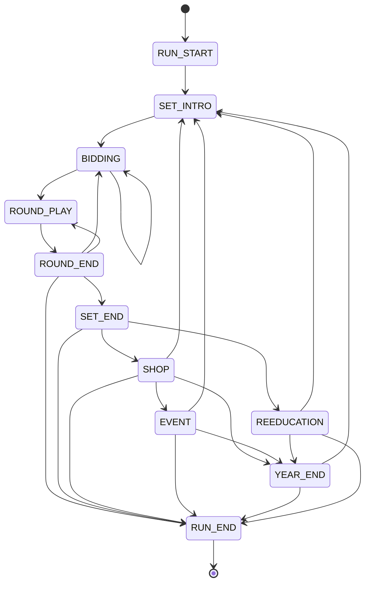

# Architecture

This file changes in the same commit as any architecture change. Decisions and their reasons are in [adr/](adr/).

## Layers

Dependencies run one way: `ui` → `game` → `core`. `core` may read definitions from `data`. Nothing in `core` references `game` or `ui`.

| Folder | Holds |
| --- | --- |
| `core/` | Pure logic: model, rules, modifiers, scoring, bots, run. No nodes, scenes, autoloads or I/O |
| `data/` | Resource definitions and the string table ([ADR 0006](adr/0006-string-table.md)) |
| `game/` | Controllers that bridge `core` to scenes |
| `ui/` | Scenes and themes |
| `art/`, `audio/`, `shaders/` | Assets |
| `tests/` | Unit, integration and golden tests |
| `tools/` | Asset scripts and headless harnesses |

`tools/layer_check.gd` enforces the `core/` rules, and the test suite runs it. It reads base types and global classes from Godot and separates code from strings. It scans `core/` and `data/`, so a data script cannot smuggle randomness in. It fails on a path outside `core/` and `data/`, a relative or `uid://` path, runtime `load()`, a Node subclass, a scene, a global class outside those folders, autoload or scene tree access, an engine singleton other than the math ones, a card setter outside `CardModifiers`, a global random function, array shuffle or pick by call, reference or name, access to `_rng`, `tr()`, runtime code evaluation, or an engine generator outside the stream service.

`tools/script_check.gd` makes every project script compile in the test suite, because exports tokenize scripts without type checking.

## Randomness

Each run has one `RandomStreams` with six independent streams: deal, shop, debuff, ai, events, cosmetic. A stream's seed is an FNV-1a hash of the run seed and its name, so adding a stream never disturbs the others. `core/` code takes a `RandomStream` and never touches an engine generator. Seeds and states serialize as text, because JSON numbers cannot hold 64 bits.

## Rules

`core/rules/` is the rules engine. Everything works on rank counts, so suits never affect legality.

| Piece | Job |
| --- | --- |
| `RuleSet` | Frozen legality parameters, built from a `RuleParams` Resource |
| `Pattern` | One play as ranks, with a comparison key fixed at construction |
| `Classifier` | Reads one Pattern from a count vector in O(15) ([ADR 0007](adr/0007-classifier-rules.md)) |
| `PlayComparator` | Decides whether one play beats another |
| `MoveGenerator` | Lists every legal Pattern for a hand |
| `CardSelection` | Maps a Pattern to card instances, and a player's picks back to a Pattern |
| `Bidding`, `LandlordSeat` | Call and grab, and who holds the seat across a Set |
| `RoundState` | One round. `apply()` is its only mutator, and it returns a reason code or emits `RoundEvent`s |

Patterns store base ranks. Only the comparison key uses the effective rank map, so chains stay adjacent in base ranks whatever a modifier does to rank order.

### Information boundary

A bot receives a `SeatView` and nothing else: a `PublicView` plus copies of its own hand. Every field of a view is an independent copy with no link back to the round, so a bot can neither reach another seat's hand nor change the round by editing what it holds. A test walks every object reachable from a `SeatView`, and another edits a view and checks the round is unchanged. The round copies the hands it is given and never hands out a `Hand`; `action_for()` turns a Pattern into an action on the controller side.

## Bots

`core/bots/` holds the bots. `Bot` is the only way the game asks for a decision, and a test fails if `core/`, `game/` or `ui/` reaches past it. Bots stay pure: a `BotBudget` carries an injected clock, worker threads live in `game/bots/`, and a `BotRationale` code replaces debug text, whose words live in `tools/` so they never ship ([ADR 0009](adr/0009-bots-and-the-core-boundary.md)).

`HandDecomposer` finds the fewest plays that empty a hand: a memoized search over chains, with a closed-form count for the rest in `DecompositionLeaf`. One instance serves one decision, so all its candidates share the memo. Quads stay bombs unless a chain takes from them, and trios stay whole, so its optimum is over those groups, not over every legal play. Four-with-two is left out for the same reason.

`UnseenCards` counts what a seat has not seen, from its view alone. `Controls` flags the groups no unseen combination can beat, so effective hands are hands less controls.

`CandidateScorer` values a candidate by the hand it leaves, from a `BotWeights` Resource. `SelfPlay` plays bots against each other through the real `RoundState`, so every harness measures the rules the game uses.

`BotPosition` works out what one decision knows, once, from the seat's view. `LeadPolicy` applies the lead rules in priority order on top of it, `FollowPolicy` the follow rules and their gates, and `SeatRole` what differs between the upstream and downstream peasants. `BidPolicy` weighs hand points against a threshold from data.

`BotConfig` picks a tier. Easy is `GreedyPolicy`. Medium is the policies above with 2s and jokers as controls. Hard adds card counting, endgame blocking and seat roles, and plays by rules alone. Expert searches every decision. `ExpertSearch` deals the unseen cards consistently with what is public and plays each top candidate out with `Rollout`, a fast count-based simulator of the Medium policy. A `BotSearchJob` holds that work, so `ExpertRunner` in `game/bots/` can spread it over the worker pool. A search only chooses among the policy's own play, a pass and the moves its gates leave open, so it never reopens a gate. A rival must beat the policy's play by a margin, so noise can't overturn it. At the deadline the job decides on the samples it finished, and with too few the policy decision stands. Tier strength is measured as in [ADR 0010](adr/0010-measuring-tiers.md), and [ADR 0011](adr/0011-tier-strength-bar.md) records the tier bars and why Expert's is low.

A `Personality` Resource holds a tier and five levels. `PersonalityTable` turns levels into numbers, and `BotConfig.from_personality()` applies them.

## Modifiers

Every Cadre, Campaign, Directive, Reform, debuff and boss twist is a `ModifierDef` Resource in `data/modifiers/`. Its behavior is a small `ModifierEffect` script registered by ID in `EffectRegistry`. `ModifierValidator` checks each definition against the hook list, its effect and the string table.

`ModifierStack` runs hooks in one order: active Cadres in slot order left to right, then active debuffs in ladder order, then the boss twist. `SeatRules` caches one RuleSet and one effective-rank map per seat, rebuilt behind a dirty flag when a modifier changes or a round starts, or when a bomb changes the trick's state. `RoundState` calls `refresh()` before each action, and queries never rebuild. A modifier runs only on the hooks its definition lists. [ADR 0008](adr/0008-rank-modifiers.md) has the rank rules.

Each hook takes one typed context:

| Hook | Context | Fields |
| --- | --- | --- |
| `build_ruleset` | `RulesetContext` | seat, landlord, params |
| `build_rank_map` | `RankMapContext` | seat, landlord, trick_bombed, rank_map |
| `on_deal` | `DealContext` | landlord, deal |
| `round_start` | `RoundContext` | landlord, winner, finish |
| `play_scored` | `PlayContext` | seat, is_landlord, pattern, add_grain, add_zeal, mul_zeal |
| `card_scored` | `CardContext` | seat, is_landlord, card, grain |
| `trick_won` | `TrickContext` | winner, landlord |
| `round_end` | `RoundContext` | landlord, winner, finish |
| `set_end` | `SetContext` | set_index, target_met |
| `shop_open` | `ShopContext` | seat |
| `meter_change` | `MeterContext` | meter, delta |

## Scoring

`Scorer` scores a play as Grain × Zeal from the `ScoreParams` Resource, then hooks apply additive Grain, additive Zeal and multiplicative Zeal, in that order. Each bomb or rocket doubles Zeal. `ScoreBreakdown` holds the ordered steps for the UI in one flat array. `HandLevels` tracks each hand type's level, and `ScoreFormat` writes short-scale numbers. `Banking` converts scores to whole pool units, rounding down, and splits the pool by need.

Card enhancements, seals and stamps change only through `CardModifiers`, and the layer check rejects their setters anywhere else in `core/` or `data/`.

## Run

`core/run/` holds the run. `RunState` is everything a run needs to resume: the seed and stream states, the Year, Set and round, the debuff ladder, both meters, the roster as `RosterEntry` rows, the player's `RunInventory` (Cadres in slot order, consumables, the private plot), coupons, the Commons pool, the landlord seat, the family in each seat, and one `SetSummary` per Set, the current Set's last. It serializes to a Dictionary of JSON-safe values, with numbers that can pass 2^53 as text.

`RunFlow` holds the run's states and the one table of moves between them; any other move returns a reason code and changes nothing. `RunState.phase` records where the run stands. A test checks this diagram against the table.

Bidding loops on itself for a redeal. A round goes back to bidding when the landlord lost, and straight to play when the seat is kept. Reeducation (P4.1) replaces a Set's shop visit, and the run can end wherever a meter moves.

`SetConfig` reads the run's shape from the `SetParams` Resource in `data/run/`: the number of Years, rounds per Set, coupons per Set type, and the target curve, one target per Set in play order. `validate()` rejects a curve that falls anywhere, across Years too.

`DebuffLadder` draws a Set's ladder at Set intro on the debuff stream, in O(rounds × pool size). Round 0 is clean, and a later round's tier is capped at its round number and at `ModifierDef.MAX_TIER`. The tier is drawn by the weights in `LadderParams`, 60/30/10 for the cap, one below and two below, with tiers under 1 dropped. A debuff never repeats or shares a lever with another in the same Set. Each round keeps one severity point of the Set's budget for every round after it, and a draw that would spend more is redrawn a tier lower, down to tier 1 ([ADR 0013](adr/0013-ladder-budget-reserve.md), proposed). A round with nothing left to draw stays clean. With the Plan's pool that happens only in the last round of a small or large Set (5.4% and 2.6% of 100,000 ladders), because the only tier-1 debuffs pull the scoring and economy levers.

`RunLoop` plays a Set round by round. Set intro draws the ladder. Each round adds its debuff to the `ModifierStack` (debuffs stack through the Set), deals a fresh deck on the deal stream, then bids. A kept seat skips bidding, and an all-pass redeals. Plot swaps come after bidding, through `PlotSwap`, one for one. What a swapped deck card becomes across rounds waits on [ADR 0014](adr/0014-plot-card-identity.md); until then a swap that would collide with a card in hand is refused. Every play is scored by `Scorer` as it happens. At round end `RoundTotals` applies the round multipliers. `RoundBanking` then banks the landlord, pools the peasants' totals, and splits the pool by declared need, with bots declaring on the ai stream. Only what reaches the player counts toward the target. The Set ends when the target is met, for its coupons, or when its rounds run out, which raises Famine. The player sits in seat 0 and acts by commands (`player_bid`, `player_swap`, `player_play`, `player_need`); `advance()` runs the bots until the player is needed. Each command returns a reason code, and a command the loop is not waiting for changes nothing. Everything the loop does is recorded as a `RunEvent`, with round play wrapped.

A Set reads only the `RunState` at its start, so the state there plus the player's commands rebuild it, the Set's log included. Numbers that later items own come from `RunParams`: a base need for every villager (P4.3), swaps per round (P4.8), and the Famine for a missed target, the one meter source so far (P4.1). The grab stake is recorded but not scored, because scoring (P1C.5) has no stake step.

## Saves

A save holds a `RunRecord`: the `RunState` where the loop last stood still, at a Set's start or end, and the player's commands since. The loop is deterministic, so `RunRecord.resume()` replays those commands on that state and rebuilds any moment in between exactly, mid-round included, with the Set's whole log. That is the full round state, kept without serializing `RoundState`. A command that no longer applies makes `resume()` return null. `RunLoop.on_boundary` is called with the loop after every state move, for autosaves; the Set-end and run-end moves mark the record first. Replay assumes the same rules and bots as when the save was written, and bots run without a deadline in the loop.

`SaveService` in `game/save/` does the file work, because `core/` has no I/O. It writes JSON with a `schema_version` to a temporary file and renames it into place, keeping the save it replaces as a `.bak`. Loading falls back to the backup when the main file is missing, damaged, or parses but fails the validator (`RunRecord.is_valid` for run saves), and returns a notice key for the player. A damaged main file never replaces the backup. A save from an older version runs through one registered migration per version step; a newer one is refused. The run save and the profile save (P4.14) are separate files with separate services. Floats are saved as their bits, because Godot's JSON writer does not round-trip every double.

## Event log

`SetLog` holds the current Set's `RunEvent`s, appended in order and cleared when the next Set starts, so memory stays flat however long a run lasts. As each round ends, `SummaryFold` folds that round's events into the Set's `SetSummary`: per villager's family, how often the player fed, bombed, denounced or betrayed them ([ADR 0012](adr/0012-set-summary-counts.md)). Folding by round keeps the summary right when a run resumes mid-Set, since the checkpoint carries the rounds before. Villager memory, epilogues and the New Landlord read summaries, never raw logs.

A view hears the log through `RunLoop.set_log`: `SetLog` hands its listener every event in order, including events that banking and meters append directly, which reach it at the next add or at `flush()`. The listener survives a Set's start, so one command that ends a Set and starts the next delivers both.

## Presentation boundary

`RunController` in `game/run/` is the only way the UI touches a run ([ADR 0017](adr/0017-demo-first-2d-3d-comparison.md) builds two table views over it). It owns the `RunLoop` and its state, and takes the UI's commands: bid, swap, play, pass, declare need, and finish a Set. Each command flushes the log and re-emits its events as `event_emitted`, then `awaiting_changed`. A refused command emits `command_refused` and changes nothing. Queries hand out copies (the seat view, the player's cards, `state_copy()`), so a view can read the run but never change it. Card selection is the hand model's, not the run's.

`tools/ui_boundary_check.gd` scans `ui/` for core loop and round types and their mutators, and the test suite runs it.
