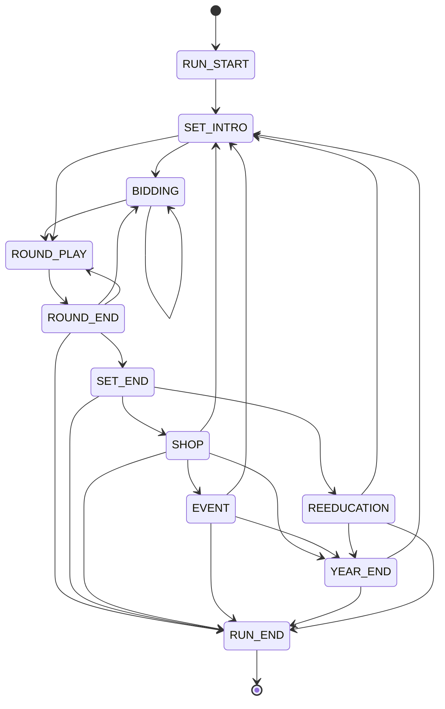

# Architecture

This file changes in the same commit as any architecture change. Decisions and their reasons are in [adr/](adr/).

## Layers

Dependencies run one way: `ui` → `game` → `core`. `core` may read definitions from `data`. Nothing in `core` references `game` or `ui`.

| Folder | Holds |
| --- | --- |
| `core/` | Pure logic: model, rules, modifiers, scoring, bots, run. No nodes, scenes, autoloads or I/O |
| `data/` | Resource definitions and the string table ([ADR 0006](adr/0006-string-table.md)) |
| `game/` | Controllers that bridge `core` to scenes |
| `ui/` | Scenes and themes |
| `art/`, `audio/`, `shaders/` | Assets |
| `tests/` | Unit, integration and golden tests |
| `tools/` | Asset scripts and headless harnesses |

`tools/layer_check.gd` enforces the `core/` rules, and the test suite runs it. It reads base types and global classes from Godot and separates code from strings. It scans `core/` and `data/`, so a data script cannot smuggle randomness in. It fails on a path outside `core/` and `data/`, a relative or `uid://` path, runtime `load()`, a Node subclass, a scene, a global class outside those folders, autoload or scene tree access, an engine singleton other than the math ones, a card setter outside `CardModifiers`, a global random function, array shuffle or pick by call, reference or name, access to `_rng`, `tr()`, runtime code evaluation, or an engine generator outside the stream service.

`tools/script_check.gd` makes every project script compile in the test suite, because exports tokenize scripts without type checking.

## Randomness

Each run has one `RandomStreams` with six independent streams: deal, shop, debuff, ai, events, cosmetic. A stream's seed is an FNV-1a hash of the run seed and its name, so adding a stream never disturbs the others. `core/` code takes a `RandomStream` and never touches an engine generator. Seeds and states serialize as text, because JSON numbers cannot hold 64 bits.

## Rules

`core/rules/` is the rules engine. Everything works on rank counts, so suits never affect legality.

| Piece | Job |
| --- | --- |
| `RuleSet` | Frozen legality parameters, built from a `RuleParams` Resource |
| `Pattern` | One play as ranks, with a comparison key fixed at construction |
| `Classifier` | Reads one Pattern from a count vector in O(15) ([ADR 0007](adr/0007-classifier-rules.md)) |
| `PlayComparator` | Decides whether one play beats another |
| `MoveGenerator` | Lists every legal Pattern for a hand |
| `CardSelection` | Maps a Pattern to card instances, and a player's picks back to a Pattern |
| `Bidding`, `LandlordSeat` | Call and grab, and who holds the seat across a Set |
| `RoundState` | One round. `apply()` is its only mutator, and it returns a reason code or emits `RoundEvent`s |

Patterns store base ranks. Only the comparison key uses the effective rank map, so chains stay adjacent in base ranks whatever a modifier does to rank order.

### Information boundary

A bot receives a `SeatView` and nothing else: a `PublicView` plus copies of its own hand. Every field of a view is an independent copy with no link back to the round, so a bot can neither reach another seat's hand nor change the round by editing what it holds. A test walks every object reachable from a `SeatView`, and another edits a view and checks the round is unchanged. The round copies the hands it is given and never hands out a `Hand`; `action_for()` turns a Pattern into an action on the controller side.

## Bots

`core/bots/` holds the bots. `Bot` is the only way the game asks for a decision, and a test fails if `core/`, `game/` or `ui/` reaches past it. Bots stay pure: a `BotBudget` carries an injected clock, worker threads live in `game/bots/`, and a `BotRationale` code replaces debug text, whose words live in `tools/` so they never ship ([ADR 0009](adr/0009-bots-and-the-core-boundary.md)).

`HandDecomposer` finds the fewest plays that empty a hand: a memoized search over chains, with a closed-form count for the rest in `DecompositionLeaf`. One instance serves one decision, so all its candidates share the memo. Quads stay bombs unless a chain takes from them, and trios stay whole, so its optimum is over those groups, not over every legal play. Four-with-two is left out for the same reason.

`UnseenCards` counts what a seat has not seen, from its view alone. `Controls` flags the groups no unseen combination can beat, so effective hands are hands less controls.

`CandidateScorer` values a candidate by the hand it leaves, from a `BotWeights` Resource. `SelfPlay` plays bots against each other through the real `RoundState`, so every harness measures the rules the game uses.

`BotPosition` works out what one decision knows, once, from the seat's view. `LeadPolicy` applies the lead rules in priority order on top of it, `FollowPolicy` the follow rules and their gates, and `SeatRole` what differs between the upstream and downstream peasants. `BidPolicy` weighs hand points against a threshold from data.

`BotConfig` picks a tier. Easy is `GreedyPolicy`. Medium is the policies above with 2s and jokers as controls. Hard adds card counting, endgame blocking and seat roles, and plays by rules alone. Expert searches every decision. `ExpertSearch` deals the unseen cards consistently with what is public and plays each top candidate out with `Rollout`, a fast count-based simulator of the Medium policy. A `BotSearchJob` holds that work, so `ExpertRunner` in `game/bots/` can spread it over the worker pool. A search only chooses among the policy's own play, a pass and the moves its gates leave open, so it never reopens a gate. A rival must beat the policy's play by a margin, so noise can't overturn it. At the deadline the job decides on the samples it finished, and with too few the policy decision stands. Tier strength is measured as in [ADR 0010](adr/0010-measuring-tiers.md), and [ADR 0011](adr/0011-tier-strength-bar.md) records the tier bars and why Expert's is low.

A `Personality` Resource holds a tier and five levels. `PersonalityTable` turns levels into numbers, and `BotConfig.from_personality()` applies them.

## Modifiers

Every Cadre, Campaign, Directive, Reform, debuff and boss twist is a `ModifierDef` Resource in `data/modifiers/`. Its behavior is a small `ModifierEffect` script registered by ID in `EffectRegistry`. `ModifierValidator` checks each definition against the hook list, its effect and the string table.

`ModifierStack` runs hooks in one order: active Cadres in slot order left to right, then active debuffs in ladder order, then the boss twist. `SeatRules` caches one RuleSet and one effective-rank map per seat, rebuilt behind a dirty flag when a modifier changes or a round starts, or when a bomb changes the trick's state. `RoundState` calls `refresh()` before each action, and queries never rebuild. A modifier runs only on the hooks its definition lists. [ADR 0008](adr/0008-rank-modifiers.md) has the rank rules.

Each hook takes one typed context:

| Hook | Context | Fields |
| --- | --- | --- |
| `build_ruleset` | `RulesetContext` | seat, landlord, params |
| `build_rank_map` | `RankMapContext` | seat, landlord, trick_bombed, rank_map |
| `on_deal` | `DealContext` | landlord, deal |
| `round_start` | `RoundContext` | landlord, round_state, table, stream, arrived, swap_cap, seize_plot, moves |
| `play_scored` | `PlayContext` | seat, is_landlord, landlord, pattern, cards_left, seat_plays, seat_grain, add_grain, add_zeal, mul_zeal, rate_percent, rate_cap, total_scale |
| `card_scored` | `CardContext` | seat, is_landlord, card, own_grain, grain |
| `turn_taken` | `TurnContext` | seat, landlord, pattern (null for a pass), cards_left, player, resentment, coupons |
| `trick_won` | `TrickContext` | winner, landlord |
| `round_end` | `RoundContext` | landlord, winner, finish, commons_scale, bank_voided, tax_percent, meter_sources |
| `set_end` | `SetContext` | set_index, target_met, coupons, add_coupons |
| `shop_open` | `ShopContext` | seat, cadre_cut |
| `meter_change` | `MeterContext` | meter, delta |
| `audit` | `AuditContext` | faces |

## Scoring

`Scorer` scores a play as Grain × Rate × Zeal from the `ScoreParams` Resource ([ADR 0020](adr/0020-grain-rate-zeal.md)). Grain is the scored cards' rank values (3 to 17) plus the hooks' additive Grain. Rate comes only from the hand type and its level (`hand_rate`), under any Rate cap a hook sets. Zeal starts at 1 and changes only through hooks, additive then multiplicative, never below `min_zeal`. A hook's `total_scale` multiplies the finished total. `ScoreBreakdown` holds the ordered steps for the UI in one flat array. `HandLevels` tracks each hand type's level, which raises its Rate, and `ScoreFormat` writes short-scale numbers and one-decimal multipliers. Modifier parameters are integers, so Zeal amounts are stored in hundredths under `zeal_percent` names, and `ModifierDef.text_values()` writes them as decimals in rules text. `Banking` converts scores to whole pool units, rounding down, and splits the pool by need.

Card enhancements, seals and stamps change only through `CardModifiers`, and the layer check rejects their setters anywhere else in `core/` or `data/`.

## Run

`core/run/` holds the run. `RunState` is everything a run needs to resume: the seed and stream states, the Year, Set and round, the debuff ladder, both meters, the roster as `RosterEntry` rows, the player's `RunInventory` (Cadres in slot order, consumables, the private plot), coupons, the Commons pool, the landlord seat, the family in each seat, and one `SetSummary` per Set, the current Set's last. It serializes to a Dictionary of JSON-safe values, with numbers that can pass 2^53 as text.

`RunFlow` holds the run's states and the one table of moves between them; any other move returns a reason code and changes nothing. `RunState.phase` records where the run stands. A test checks this diagram against the table.

Bidding loops on itself for a redeal. A round goes back to bidding when the landlord lost, and straight to play when the seat is kept. Reeducation (P4.1) replaces a Set's shop visit, and the run can end wherever a meter moves.

**Meters (P4.1).** `data/run/meters.tres` is a `MeterTable`:

- `MeterBands` for each meter: the low, mid, high and death thresholds, plus a re-arm margin.
- One `MeterSource` row per cause of change: missed target, Commons shortfall, private purchase, caught lie, and a band-sized row for each meter's debuffs.
- The store slots that rationing cuts.

`RunMeters.apply(source)` handles every change:

1. It runs the change through the `meter_change` hook and clamps the result.
2. It logs `METER_CHANGED`.
3. It fires the mid-band setback once per upward crossing. The flags for this live in `RunState`. A setback re-arms only after the meter falls below mid minus the margin.

The two setbacks:

- **Rationing** holds while Famine stays up. `RunShop.slot_count()` cuts the store's slots for as long as it lasts.
- **Reeducation** is owed once. `open_shop()` serves it in place of the store: the run moves to `REEDUCATION`, the plot is emptied, and one held Cadre is exchanged ([ADR 0019](adr/0019-reeducation-setback.md)).

Death is checked after each meter move, at a state that may go to `RUN_END`: Set end, or round end for a shortfall. The run log gets `RUN_DIED`, naming the meter. Run saves are schema 10 (`RunRecord.migrate_from_9` adds the final Year's class counters; `RunRecord.migrate_from_8` added the Slogan's hand type; `RunRecord.migrate_from_7` added the Reforms and the gathered deck; `RunRecord.migrate_from_6` added the Cadres' run state; `RunRecord.migrate_from_5` added card marks and hand levels, and `RunRecord.migrate_from_4` added the norm, both P4.11; `RunRecord.migrate_from_3` added `store_sold`, P4.10); `RunRecord.migrate_from_2` added the setback flags and Resentment for schema 3.

**Resentment (P4.2).** `RunState.resentment` runs from 0 to 100. `Resentment` and `data/run/resentment.tres` define what raises it:

- each black market purchase, a Cadre or a plot upgrade (`RunLoop.player_market_buy`, `player_upgrade`);
- each private Cadre held at a Set's end;
- each card the player scores that carries their own stamp.

Resentment acts in two ways:

- **Denunciation.** At each Set's end, Denunciation rises by `denunciation.sample(resentment / max)`, through the meter table's `resentment` row. That curve is the only mapping from Resentment to Denunciation.
- **Grudge.** At each round's start, every bot's `memory[player]` is set to `grudge(resentment)`. A bot's spite (grudge × memory) is added to every answer it scores. It also divides its cooperation, so a resented player's teammate covers for them less often.

**Declared need (P4.3).**
- **Declaring.** Every peasant declares a need before the split. Bots lie as their honesty says, and the player may declare any value.
- **Auditing.** `NeedAudit` then checks each declaration on its own `audit` stream. Each declaring seat rolls one die (`audit.tres`: six sides), and a face at or below the audit faces means its claim is checked. The faces are the base of one, plus one while an informer family is seated or active on the roster, then whatever the `audit` hook adds, capped at `max_faces` so a check is never certain. Every seat rolls once, so the stream moves the same whether anyone lied or not. Each roll is logged as `AUDIT_ROLLED` with the face shown, before any `AUDITED`, and the table plays it as two dice in a bowl (`DiceBowl`), so the chance the need panel shows is the die's ([ADR 0021](adr/0021-starter-content-set.md)).
- **Overfulfilment and the norm.** At a met Set's end `RunLoop._overfulfil` counts one step for each full `over_step_percent` the Set beat its target by, up to `over_max_steps` (`SetParams`). Each step pays a coupon, adds Resentment and adds to `RunState.norm_steps`, logged as `OVERFULFILLED`. `RunLoop.target()` is the curve's target, then any boss's change, then the norm: `norm_percent_per_step` for every step earned in earlier Sets. `RunState.over_steps` holds the finished Set's own steps until the next Set starts, so the Quota report still reads the target that Set was played against.
- **Marks on cards.** Both marks are drawn on a card's left edge, under its index, where a fanned hand still shows them (`ui/cards/card_mark.gd`). The deck is built new for every deal, so `CardMarks` (`core/run/card_marks.gd`, saved in `RunState.card_marks`) keeps each deck card's owner stamp and enhancement by card ID, and `RunLoop._deal_cards` puts them back through `CardModifiers`. A plot card carries its own marks, saved with the plot. A deck card swapped into the plot takes its marks with it, so a mark is never doubled. `CardMarks.stamp` and `CardMarks.make_model` are the entry points for Campaigns. A Model card (`CardInstance.MODEL`) scores `model_grain_percent` of its Grain for whoever scores it: `Scorer` raises the card's own value before any hook runs, and a kicker still scores nothing.
- **Hand levels and Directives.** Each hand type's level is saved in `RunState.hand_levels`, and the loop scores with it. A `DirectiveDef` (`data/modifiers/directives/`, pooled in `data/run/directive_pool.tres`) names the hand types it raises. The state store draws `directive_slots` of them on the shop stream after every other shop draw, leaving out a family already at the top level, and a reroll redraws them. Buying one is the `directive` command (`RunLoop.player_directive`): it costs its price and raises each of its types one level at once. `ModifierDef` and `DirectiveDef` carry an `unlock_tier` that nothing reads until P4.14.
- **Campaigns.** A `CampaignDef` (`data/modifiers/campaigns/`) is a one-use item held in `RunInventory.consumables`, up to `campaign_slots`. Its behaviour is a `CampaignEffect` in `core/campaigns/effects/`, registered by ID in `CampaignRegistry`. Each shop draws `campaign_offers` from its own pool (`CampaignCounter`) at the very end of `open_shop()`, and a reroll redraws them. Two saved commands drive them: `campaign_buy`, and `campaign` (the held slot and the chosen card IDs, `RunLoop.player_campaign`). A refused use changes nothing; `campaign_reason` gives the code the UI explains.
  - **When.** Most are used on the player's turn. Mutual Aid and Appeal need a moment before the landlord's first play, which a peasant never has, so the loop stops at `Awaiting.PLAYER_OPENING`, after the plot swap, only while a peasant holds a Campaign usable there. The `begin` command ends the wait. It sits inside the round's play state, so the run-state table is unchanged.
  - **Round effects** (the doubled-or-nothing stake, the forced pass, the lifted debuff) live in `CampaignRound`, reset at each round's start and end and rebuilt by replaying the Set's commands, so nothing is added to the save.
  - **Hands.** `RoundState.trade()` swaps cards one for one between two seats mid-round and `RoundState.mark()` marks a live card. A kitty card that leaves the landlord's hand is dropped from the public kitty, because the Expert bot deals the unplayed kitty to the landlord when it samples hands. Bots never use Campaigns; `AidChoice` picks what a teammate gives in Mutual Aid.
  - **Meters.** Grain Loan's Famine goes through the `campaign_famine` row. In a shop a death ends the run at once; at the table it is found at the round's end, where every round already checks.
- **Reforms.** A `ReformDef` (`data/modifiers/reforms/`, pooled in `data/run/reform_pool.tres`) is a permanent upgrade, held as an ID in `RunState.reforms` for the rest of the run. Its behaviour is a `ReformEffect` in `core/reforms/effects/`, registered by ID in `ReformRegistry`. An effect changes nothing itself: it answers a question from its parameters.
  - **One reader.** `RunReforms` (`core/run/`) is the only place the run asks those questions: `cadre_slots`, `campaign_slots`, `quota_coupons`, `missed_famine`, `extra_envelope_choices` and `gathers_deck`. Both shops, the controller and both boards take the player's limits from it, starting from the state store's `ShopParams`; the black market's own `cadre_slots` and `campaign_slots` are not read.
  - **The offer.** `ReformCounter` draws `reform_offers` (state store 1, black market 0) last of all in `open_shop()`, after the Campaigns, so a Reform changes no stock drawn before it. It never offers one that is held, or one whose `held_back` flag is set (none is, today). A reroll redraws it. The saved command is `reform` (`RunLoop.player_reform`).
  - **Unplanned Economy** deals without a shuffle between the rounds of a Quota. At a round's end `DeckOrder.gather` takes the cards in the order they were played, then each seat's unplayed cards in seat order, then the unplayed kitty, into `RunState.deck_order`. The next deal cuts that order once on the deal stream and deals it in blocks through `Dealer.deal_in_order`, so cards played together tend to land in one hand. The order is cleared at a Set's start and end and before a redeal, so a Quota's first round and every redeal are shuffled. A deck card that went into the plot goes back at the end of the order. Measured over about 3,000 deals each way, it raises four-of-a-kinds from 0.29 to 1.32 a deal, for every seat; P4.16 tunes it.
  - **Grain Reserve** takes its relief off the missed Quota's Famine before the meter-change hook runs.
- **Endings.** `Endings` (`core/run/`, pure and static, [ADR 0024](adr/0024-endings.md)) works out how a run ended from the final `RunState` alone, so a save loaded at `RUN_END` gives the same page.
  - **Class** is the final Year's: `RunState.year_rounds` and `year_landlord_rounds` (schema 10) are counted at each round's end and reset when a Year starts, and `YearClass.is_landlord` is true at half or more. The landlord seat cannot be read at the end, because it is cleared with each Quota.
  - **Outcome.** A meter at its death threshold gives `death_famine` or `death_denunciation`, read from the saved meters, Denunciation first. Otherwise the class and the meter in its high band pick one of six endings; when both are high the larger decides, and Denunciation a tie. The Commons replaces The Secret Contract when Resentment is at or below `EndingParams.collective_resentment` and both meters are below mid.
  - **Epilogue.** One `EpilogueLine` for every family that is not dead, in roster order: its state's line in reeducation or deposed, otherwise the ending's line for its disposition (warm below zero weighted grudge, bitter at or above `bitter_pull`, wary between), from `VillageMemory`. Lean Years and Full Granary, Empty Village add a line naming the dead. A death has none.
  - **Text** is in the string table, generated from the ADR; `tests/unit/test_ending_text.gd` compares the two word for word.
  - **Screen.** `RunController.ending()` hands the screen an `EndingView` (`game/run/`) of plain data. `EndingScreen` shows the title card, the text, the meters and class, and the lines one per `MotionPresets.epilogue_beat`, with an accept press showing them all. Ending pictures go in `ArtLibrary.endings`; until they exist the title stands on a code-drawn sheet (`EndingPaper`). `HanziSeal` draws Struggled's seal only from a font that holds the characters (`ArtLibrary.hanzi_font`, empty today, so no seal shows).
- **Debuffs.** All 20 of the Plan's debuffs are `ModifierDef`s in `data/run/debuff_pool.tres`, built to [ADR 0023](adr/0023-debuff-pool.md). A debuff stays in force for the rest of its Quota. Most are plain hook effects. `RunDebuffs` (`core/run/`, beside the loop as `RunCampaigns` is) holds what a round's debuffs do outside their hooks, for one round, rebuilt by replay:
  - **Slogan of the Week.** Its hand type is drawn on the debuff stream after the ladder's own draws, only when the ladder holds it, and saved as `RunState.slogan_type` (schema 9). It is bound onto the effect when the stack is built. `PlayContext.rate_percent` halves the Rate, rounded up, before any Rate cap.
  - **Confiscation** draws one held Cadre on the debuff stream when the round's stack is built and disables it for the round, memo untouched. Appeal hands it back at once.
  - **Cards that move.** Levy and Redistribution run in `round_start`, after the kitty and before the plot swap, through `RoundContext.trade()` onto `RoundState.trade()`, and are logged as `CARDS_PASSED`. "Left" is the previous seat in turn order, which is the seat drawn on the player's left. Redistribution draws on the deal stream.
  - **Plot.** Shared Kitchen caps the round's swaps (`RoundContext.swap_cap`, read through `RunLoop.swap_limit()`). Plot Seized destroys one plot card, drawn on the deal stream, in the round it arrives (`PLOT_SEIZED`), and allows no swap after.
  - **Banking.** Grain Tax and Overtime set `tax_percent` and `bank_voided` at `round_end`; `BankCut` applies them to what the player banks, after any Campaign stake, and logs `GRAIN_TAXED` or `BANK_VOIDED`. Only progress toward the Quota is cut.
  - **Meters.** Big-Character Poster and Hungry Winter name a meter table row in `RoundContext.meter_sources` when the player's side loses.
  - **Rules.** Night Shift sets `RuleSet.must_answer_once`: `RoundState` refuses the player's first pass against a play they can beat (`Reason.MUST_PLAY`). Glass Walls sets `hand_shown`: `RoundState.view_for` then gives the other seats `SeatView.exposed`, `BotPosition.threats` narrows to what an opponent can really hold, and the Expert bot deals the shown hand exactly when it samples.
  - **Short Supply** runs the `shop_open` hook over the finished Quota's debuffs that came into force, and its `ShopContext.cadre_cut` shortens the next state store only.
  - **Work-Point Audit** adds two faces through the `audit` hook, under the cap.
- **Envelopes.** An `EnvelopeDef` (`data/modifiers/envelopes/`) is a pack: bought, opened at once, and the player keeps one of its items or nothing. `ShopParams.envelopes` lists the kinds a shop sells and `envelope_offers` how many it shows (one each): the state store a Directive or a Campaign envelope, the black market a Parcel.
  - **The offer.** `EnvelopeCounter` draws it last of all in `open_shop()`, after the Reforms. A kind with nothing to show is not offered. A reroll redraws it, and a bought one stays sold for the visit.
  - **Contents** are drawn when the envelope is bought, by `EnvelopeContents`, on a stream seeded from the run seed, the Set number and the envelope's ID. So the same purchase always holds the same items, nothing is added to the save, and opening one shifts no other draw. An envelope holds `choices` items plus `RunReforms.extra_envelope_choices`, none twice, fewer if fewer can be drawn. A Directive at its top level is never drawn. A Parcel draws each place by `weights` from private Campaigns, stamped plot cards and Model plot cards.
  - **Commands.** `envelope_buy` and `market_envelope` buy and open; `envelope_pick` keeps the item at an index, or nothing with -1. While an envelope is open every other shop command, leaving the shop and using a shop Campaign are refused, and a save taken then loads back into the open envelope. A Parcel's Resentment is charged when it is bought.
  - **Keeping.** A Directive is issued through `RunShop.issue`, the one path that raises hand levels. A Campaign joins the held ones and is refused while they are full. A plot card is made under `RunState.take_plot_id()`, marked through `CardMarks`, and stored through `PlotSwap.store`; it is refused while the plot is full. A plot card's marks are saved with the card.
  - **Screen.** `EnvelopeShelf` (`game/run/`) feeds `EnvelopeStall` on the counter and `EnvelopeOverlay`, which opens over the shop page behind a shared `Scrim`. Cancel moves focus to "Take nothing" and a second press confirms it.
- **What a Cadre remembers.** `RunState.cadre_memos` (`CadreMemos`: Cadre ID to a `CadreMemo` of named ints) holds a Cadre's run state: a picked rank, Years held, growth and counts. The stack binds the memo onto the effect when it is built (`ModifierStack.add(def, seat, memo)`), as it binds `parameters` and `holder_seat`, so no effect touches `RunState`. Buying a Cadre resets its memo, and losing one (reeducation, The Purge) drops it. An effect that pays or grows calls `memo.fire(amount)`, which the loop logs as `CADRE_FIRED`, and the table pulses that Cadre's card and shows its count.
  - **`turn_taken`** runs after every real play or pass and never for a preview, because `play_scored` also runs for previews and must stay read-only. All counting happens there, and so does the Resentment a Cadre adds.
  - **Stacking on one card.** Model doubles the printed Grain before any hook. `CardContext.own_grain` is that value, fixed before hooks, and a hook that multiplies (Poor Peasants' Association) adds a multiple of it, while flat Grain (Red Banner, Red Ink) is added and never multiplied. The order of hooks then does not matter, with one old exception: Landlord's Ledger doubles the running Grain.
  - **Zeal** is the floor, or (1 + the flat Zeal added) times every multiplier. Multipliers sit inside Zeal, so a total cut by a debuff still shows as a last factor.
  - **A picked rank.** A `ModifierDef` with `needs_rank` takes a rank at purchase (`market_buy` carries it), kept in the memo. Without one, the data's rank is the fallback.
  - **Class Label** is per rank, because the rank map is: while the holder is landlord, a rank is raised only while every card of it in the holder's hand carries their stamp. `RoundState` works out that mask before each action, and the seat whose play is on the table keeps the mask it played under.
  - **Events.** Eight run events (`CAMPAIGN_USED`, `CARDS_MARKED`, `CARDS_MOVED`, `PASS_FORCED`, `LETTER_LAPSED`, `STAKE_SETTLED`, `DEBUFF_LIFTED`, `COUPONS_GAINED`) let the table play each use from the log. The tray is `ui/screens/campaign_tray.gd`: at the table a row of full-size leaflets under the left seat, hidden while nothing is held, with no empty places. A leaflet that cannot be used now is never faded; it says "Not now". The beats are in `ui/table2d/campaign_moments.gd`. `commons_campaign` (C, or d-pad up) reaches the tray.
- **Caught lies.** A declaration above true need (`RunParams.base_need` until P4.5) is a lie. A checked lie is replaced by the true need before `Banking.split`.
- **What a caught lie costs.**
  - The player: the meter table's `caught_lie` row.
  - A villager: the same amount, added to `RunState.villager_denunciation` for their family.

**Free riding (P4.4).**
- `RunState` tracks two run-wide totals: the Commons shares paid to the player (`commons_received`) and to every peasant (`commons_paid`).
- At each round's start, the player's peasant teammate gets an `effort` from `FreeRiding.effort`. Effort stays at 1 up to `free_ride.tres`'s fair share, then falls to the bot's own cooperation at the full share.
- A bot's decision slacks when its own salted roll lands at or above its effort, kept apart from the cooperation roll. A slacking bot uses `SlackPolicy`: it passes when following and leads its weakest legal move. A slacked decision never reaches the Expert search.

**Roster (P4.5).** `data/villagers/village.tres` is a `VillageBook`. It holds the 14 Plan families and 2 sent-down youth templates, each a `FamilyDef`:

- a personality, voice, portrait with its face rectangle, and its own `SpeechBook`;
- when it joins the village: at the start, after a number of finished runs, or after a landlord ending;
- two flags: `rising` (the family gains a bot tier as it sits) and `mirrors_player` (filled in by P4.7).

`tools/make_families.py` writes these files from one table. The surnames and speech strings it adds go into `strings.csv`.

`Roster.start` puts the starting and unlocked families into `RunState.roster`. When a run has a roster, `RunLoop.start_set` calls `Roster.prepare_set` on the `events` stream, which:

1. counts down reeducation timers;
2. spawns sent-down youth, with a surname nobody living holds, until two opponents are available;
3. seats two families and sets their bot configs from their personalities.

The seats get their configs from `Roster.config_for`, seeded from the run seed, the Set and the seat. A family whose own Denunciation reaches mid goes to reeducation at the Set's end, logged as `ROSTER_CHANGED`. A run without a roster, such as the demo or most tests, keeps the seats and configs it was given.

The UI reads the seated family through `RunController.seated(seat)`: name, portrait crop, and the family's speech lines alongside the shared book.

**Villager memory (P4.6).** `VillageMemory` keeps per-family counts of how often the player fed, bombed, denounced and betrayed them.

- **Within a run.** The counts are built from each Set's `SetSummary` at Set end and kept in `RunState.memory`.
- **The profile save.** `game/save/profile.gd` is a separate file, `user://profile.json`, with its own schema version 1 and validator. It holds the memory, and the controller writes to it at each Set end and run end.
- **Across runs.** `start_run` loads the profile and calls `carried()`, which keeps `kept_per_run` of every count.
- **At the table.** At each round's start, a seated bot's `memory[player]` is Resentment's grudge plus its family's `pull`: the weighted grudge from `data/villagers/memory.tres`, divided by `full_grudge` and clamped to 0..1. The bot's own grudge parameter then scales it.
- **Tests.** `Saves.use_run_path` also moves the profile to a file beside the run save, so tests never touch the real profile.

**Bosses (P4.7).** `data/run/boss_pool.tres` (`BossPool`) holds four authored officials as `BOSS_TWIST` modifiers, plus the risen-villager and New Landlord twists:

| Boss | Twist |
| --- | --- |
| Struggle Session | `on_deal` swaps your highest card into the kitty for its lowest |
| Requisition | your Bombs and Rockets score 0 |
| Great Leap | +0.5 Zeal, and `quota_percent` doubles `RunLoop.target()` |
| The Purge | destroys a Cadre at the Set's start |

At a boss Set's start, `Bosses.choose` picks the boss on the `events` stream:

- the New Landlord in the run's last Year;
- otherwise an unused risen villager in even Years;
- otherwise an official, with no repeats until all four have run.

The boss's modifier joins the stack after the debuffs, and the Set intro names it and its rule.

- **Risen villagers.** A family that held every round's landlord seat in a Set joins `RunState.risen`, read from the Set's `SEAT_KEPT` and `SEAT_LOST` events. As a boss, it takes seat 1 and starts the Set as landlord. That is the reading of the Plan's "villagers who entrenched as landlord".
- **The New Landlord.** Each Set, the player's style (`PlayerStyle`: hand-type counts, calls and bid turns) is kept for the last three Sets. `PlayerStyle.mirror` turns them into the New Landlord's play: a per-type score bonus (`BotConfig.type_bias`, added in `CandidateScorer.score_play`) and an ambition matching the bid rate. Deng's `mirrors_player` uses the same mirror whenever Deng is seated.

**Private plot (P4.8, [ADR 0014](adr/0014-plot-card-identity.md)).**

- **Timing.** The round starts, with the kitty taken, before the swap step. The player can swap up to `PlotSwap.swaps()` cards (data `swaps_per_round` plus `RunState.swap_bonus`), kitty cards included.
- **The swap.** `RoundState.exchange` trades cards in the hand before the first play. A deck card that enters the plot is reissued under `RunState.take_plot_id()`, which runs past every plot ID ever held.
- **Capacity.** `PlotSwap.capacity()` is data `plot_capacity` plus `plot_capacity_bonus`. `PlotSwap.store()` adds a card only below capacity; the black market's `PlotStall` uses it to put a bought card in the plot.
- **Duplicate ranks.** A fifth copy of a rank in hand reads by the RuleSet's `five_plus_is_bomb`.

**Deal, stamp and information effects (P4.9).**

- **Deal.** `DealContext` carries the deal stream. Planned Allocation's `on_deal` calls `Dealer.rebias`, which applies P1A.7's bounded swaps to the finished deal, so it runs in hook order with the other deal effects.
- **Stamps.** Red Ink checks `owner_stamp()` in `card_scored`. A stamped card scores extra only for its owner, unless `for_anyone` is set.
- **Information.** Upgrades change nothing in play. Their `info` parameter sets `InfoView` flag bits. `RunLoop.player_view()` attaches an `InfoView` (opponents' remaining hand types, or the closest hand's cards) only when the player holds such a flag. Bots' views never carry one, so with no flags the player's view equals the bots' public view.
- **Stock.** These four private items sit in `data/run/market_pool.tres`, the black market's stock for P4.10.

`SetConfig` reads the run's shape from the `SetParams` Resource in `data/run/`: the number of Years, rounds per Set, coupons per Set type, and the target curve, one target per Set in play order. `validate()` rejects a curve that falls anywhere, across Years too.

`DebuffLadder` draws a Set's ladder at Set intro on the debuff stream, in O(rounds × pool size). Round 0 is clean, and a later round's tier is capped at its round number and at `ModifierDef.MAX_TIER`. The tier is drawn by the weights in `LadderParams`, 60/30/10 for the cap, one below and two below, with tiers under 1 dropped. A debuff never repeats or shares a lever with another in the same Set. Each round keeps one severity point of the Set's budget for every round after it, and a draw that would spend more is redrawn a tier lower, down to tier 1 ([ADR 0013](adr/0013-ladder-budget-reserve.md)). A round with nothing left to draw stays clean. With the Plan's pool that happens only in the last round of a small or large Set (5.4% and 2.6% of 100,000 ladders), because the only tier-1 debuffs pull the scoring and economy levers.

`RunLoop` plays a Set round by round. Set intro draws the ladder. Each round adds its debuff to the `ModifierStack` (debuffs stack through the Set), deals a fresh deck on the deal stream, then bids. A kept seat skips bidding, and an all-pass redeals. Plot swaps come after bidding, through `PlotSwap`, one for one. A deck card swapped into the plot is reissued under a plot ID ([ADR 0014](adr/0014-plot-card-identity.md)). Every play is scored by `Scorer` as it happens. At round end `RoundTotals` applies the round multipliers. `RoundBanking` then banks the landlord, pools the peasants' totals, and splits the pool by declared need, with bots declaring on the ai stream. Only what reaches the player counts toward the target. The Set ends when the target is met, for its coupons, or when its rounds run out, which raises Famine. The player sits in seat 0 and acts by commands (`player_bid`, `player_swap`, `player_play`, `player_need`); `advance()` runs the bots until the player is needed. Each command returns a reason code, and a command the loop is not waiting for changes nothing. Everything the loop does is recorded as a `RunEvent`, with round play wrapped.

A Set reads only the `RunState` at its start, so the state there plus the player's commands rebuild it, the Set's log included. Numbers that later items own come from `RunParams`: a base need for every villager (P4.3) and swaps per round (P4.8). The grab stake is recorded but not scored, because scoring (P1C.5) has no stake step.

**Bidding order and cost.** The first bidder rotates with the year, Set and round, so no seat always speaks first. `Bidding` gives the caller the last word: a caller whose seat was grabbed may grab it back once. Calling an open seat is free. When the player takes a seat a villager holds, `RunLoop.player_bid` adds `ResentmentParams.grab` Resentment with cause `Resentment.GRAB`; villagers' grabs add none, because Resentment is only what the village holds against the player. `RunLoop.audit_chance()` gives the chance each declared need is audited at the round's split, so the table can state it before the player declares.

## Saves

A save holds a `RunRecord`: the `RunState` where the loop last stood still, at a Set's start or end, and the player's commands since. The loop is deterministic, so `RunRecord.resume()` replays those commands on that state and rebuilds any moment in between exactly, mid-round included, with the Set's whole log. That is the full round state, kept without serializing `RoundState`. A command that no longer applies makes `resume()` return null. `RunLoop.on_boundary` is called with the loop after every state move, for autosaves; the Set-end and run-end moves mark the record first. Replay assumes the same rules and bots as when the save was written, and bots run without a deadline in the loop.

`SaveService` in `game/save/` does the file work, because `core/` has no I/O. It writes JSON with a `schema_version` to a temporary file and renames it into place, keeping the save it replaces as a `.bak`. Loading falls back to the backup when the main file is missing, damaged, or parses but fails the validator (`RunRecord.is_valid` for run saves), and returns a notice key for the player. A damaged main file never replaces the backup. A save from an older version runs through one registered migration per version step; a newer one is refused. The run save and the profile save (P4.14) are separate files with separate services. Floats are saved as their bits, because Godot's JSON writer does not round-trip every double.

## Event log

`SetLog` holds the current Set's `RunEvent`s, appended in order and cleared when the next Set starts, so memory stays flat however long a run lasts. As each round ends, `SummaryFold` folds that round's events into the Set's `SetSummary`: per villager's family, how often the player fed, bombed, denounced or betrayed them ([ADR 0012](adr/0012-set-summary-counts.md)). Folding by round keeps the summary right when a run resumes mid-Set, since the checkpoint carries the rounds before. Villager memory, epilogues and the New Landlord read summaries, never raw logs.

At the same point `ObservationFold` adds the round to `RunState.observations`, which is the dossier's source. It counts, per villager family, what the player saw that villager do across the run: bid turns and calls, bombs, passes, plays over a teammate, first-out finishes, and rounds as landlord. It never records a personality. Run saves went from schema 1 to 2 for this field. The 1-to-2 migration (`RunRecord.migrate_from_1`) gives an older save an empty record.

A view hears the log through `RunLoop.set_log`: `SetLog` hands its listener every event in order, including events that banking and meters append directly, which reach it at the next add or at `flush()`. The listener survives a Set's start, so one command that ends a Set and starts the next delivers both.

## Presentation boundary

`RunController` in `game/run/` is the only way the UI touches a run ([ADR 0017](adr/0017-demo-first-2d-3d-comparison.md)). It owns the `RunLoop` and its state, and takes the UI's commands: bid, swap, play, pass, declare need, and finish a Set. Each command flushes the log and re-emits its events as `event_emitted`, then `awaiting_changed`. A refused command emits `command_refused` and changes nothing. Queries hand out copies (the seat view, the player's cards, `state_copy()`), so a view can read the run but never change it. Card selection is the hand model's, not the run's.

`tools/ui_boundary_check.gd` scans `ui/` for core loop and round types and their mutators, and the test suite runs it.

## Autoloads

Four singletons, and no more (P3B.2): `Settings` (`SettingsStore`: player settings in `user://settings.cfg`, defaults from `data/settings/default_settings.tres`), `Strings` (`StringTable`: string-table keys to text), `Saves` (`SaveHub`: the run save service) and `Audio` (`AudioMixer`: the Music, Effects and Voice buses and their volumes). None holds run state; the run lives in `RunController`. The Godot AI add-on's `_mcp_game_helper` is a development autoload that export presets exclude ([ADR 0017](adr/0017-demo-first-2d-3d-comparison.md)). `tests/integration/test_autoloads.gd` checks the list exactly.

## Hand model

`HandModel` in `game/hand/` is the player's hand as the table view sees it ([ADR 0017](adr/0017-demo-first-2d-3d-comparison.md)): which cards are selected, how the selection reads, its projected score and the hint. Selection is local to the view; playing it goes through `RunController`. `RoundState.read_play()` reads a seat's cards against the table without playing them, and `apply()` plays through the same reading, so a preview and a play can never disagree on legality. `RoundScoring` scores a round's plays as they happen and previews a play through the same path, so the projected score equals the scored one. A preview changes nothing: hooks learn how many plays the seat made before from `PlayContext.plays_before`, so effects keep no state of their own. A label key names the pattern (`pattern.*`) or the reason Play is off (`hand.reason.*`). Hints light every card whose rank appears in a legal move, since moves are over ranks.

## State store

`RunShop` in `core/run/` is the state store between Sets (part of P4.10, per [ADR 0017](adr/0017-demo-first-2d-3d-comparison.md)). After a finished Set, `RunLoop.open_shop()` moves to the shop state and draws stock: up to `ShopParams.slots` Cadres the player doesn't hold, from `data/run/cadre_pool.tres`, weighted by rarity, on the shop stream. Buying spends coupons and appends the Cadre to the inventory; a reroll draws new stock for a price that rises with each reroll in the visit. Stock is never saved. The shop visit, purchases and rerolls are record commands (`shop`, `buy`, `reroll`), so a save taken in the store replays the visit from the Set's end and draws the same stock. `next_set()` leaves the store; from a finished Set it still passes straight through, which harnesses use. The black market is the same class with other numbers:

**Two shops (P4.10).** `RunShop` is one counter, and the run has two: `RunLoop.shop`, the state store, and `RunLoop.market`, the black market. `open_shop()` opens both for the visit, the store first, so both draw on the shop stream in a fixed order. They differ only in data: `data/run/default_shop.tres` and `data/run/black_market.tres` are both `ShopParams`, with `price_percent` (100 and 150, rounded up) and `stock_per_item` (1 and 0 for no limit), and each has its own reroll costs and rarity weights. `data/run/cadre_pool.tres` holds only collective Cadres and `data/run/market_pool.tres` only private ones; a test checks both. The state store's limited stock is `RunState.store_sold`, a count per item for the run: an item it has sold out of is not restocked, even if the player later loses it. The black market also sells private-plot upgrades through `PlotUpgrades` and `data/run/plot_upgrades.tres`: one more card of capacity or one more swap a round, each up to a limit, raising the bonuses `PlotSwap` already reads. It sells cards for the plot too: `PlotStall` offers a few each visit, their rank and suit drawn on the shop stream after both counters' stock, and a bought card enters the plot under a new plot ID through `PlotSwap.store`. Every black market purchase, Cadre, card or upgrade, adds `ResentmentParams.private_purchase` Resentment with cause `Resentment.PRIVATE_PURCHASE`; a refused purchase adds none. The `private_purchase` row of the meter table is not used: the Plan routes Denunciation through Resentment, so a purchase is not charged twice. The record commands are `market_buy`, `market_reroll`, `upgrade` and `plot_card`. A reroll is offered only when the counter has more to offer than it has slots (`RunShop.reroll_changes`). Screens read a counter through `ShopDesk` (`RunController.desk(market)`), and `StoreScreen` is both shops: `black_market_screen.tscn` sets its `market` flag, which darkens the room, seals purchases "paid" in black, shows the Resentment count and the upgrade tickets. A Cadre with no art yet shows its name on the card stock. On the table, `IntelText` turns the player's `SeatView.info` into a line on each villager's seat, which is where The Informant and Peek show what they reveal, and `TableScreen` opens the plot swap screen when the run waits on a swap.

**Shop layout.** Both shop pages are four rows inside the page margins: the heading with a notes column (the rationing note or the market's warning, then the "Reforms in force" strip), the Cadre cards with the Directive column or the plot stall, the buttons, and the board with an "On the counter" row. The counter row holds equal compact panels (`CounterPanel`): the Campaign offer, the Reform offer and the envelope offer. A shop Cadre card prints its art, or an empty printed frame (`ArtFrame`), then its name, its full rules and Buy. The shop's note is printed on the Reforms strip's sheet. One shared `DetailSlip` shows the full rules of whatever is hovered or focused, and clicks pass through it. `StoreCard` and `MarketGoods` are split out of `StoreScreen`. `NoticeBoard.setup(slots, box)` shrinks the Cadre cards to fit their box, so six fit after Enlarged Committee. `tests/integration/test_shop_layout.gd` checks both pages at 1920x1080 and 1280x800, empty and full: every visible control is on screen and no main block overlaps another. It also checks an open envelope with three and four choices. `tests/integration/test_campaign_tray_layout.gd` does the same for the table tray, and `tests/integration/test_readability.gd` holds the type sizes: a name or rule the player must read is dark ink over the grime, never under 16 px at 1080 (13 px on the small notice-board cards), and nothing rules-relevant is shown by hover alone.

At each round's start the loop rebuilds its modifier stack from the player's Cadres in slot order, then the ladder's debuffs so far, as the hook order says.

`RunController` saves through its `SaveService` after every state boundary and every accepted command, so quitting at any moment loses nothing.

## Demo app and screens

`ui/main.tscn` runs `DemoApp` ([ADR 0017](adr/0017-demo-first-2d-3d-comparison.md)), which owns the `RunController`, the `HandModel` and a `SceneSwitcher` (`game/scenes/`). The switcher shows one screen at a time under a host node, with a back stack. Each screen is its own scene and gets the app in `open()`; the run lives beside the switcher, never in a screen, so changing or going back between screens keeps it. The demo is one Year (`data/run/demo.tres`): title, run setup, Set intro with the ladder, table, Set summary, state store, Year summary, settings and a closing screen. More screens open over these: the dossier and last-round summary from the table menu, the black market from the store, and the collection and village history from the title. The plot swap opens when the run waits on a swap. A run with a village roster that ends, by surviving its last Year or by dying, opens the ending screen (`DemoApp.screen_for`); the demo has no roster and still closes on its Year summary, so the ending screen is reached today only by loading a full run's save. Screens whose systems are still to come show what `RunState` holds today. The table is the 2D `ui/table2d/table_screen.tscn` unless the build has the `table_3d` feature.

The 2D table renders the run's events through an `EventPlayer`, which spaces bids, plays, passes and trick ends a step apart so each bot play can be seen, and holds still during a hit-stop. It reads the run only when the queue is empty. Card views come from the table's `CardPool`, and ledger rows and notice-board slots are made once, so nothing is instanced during a round.

`TableInput` handles the keyboard and gamepad at the table. The `commons_*` actions in `project.godot` give play, pass, hint, sort and rules the same button a click presses. `commons_cursor_left`, `commons_cursor_right` and `commons_select` move a cursor along the hand and toggle the card under it. The table's buttons never take focus, so A or Space can't land on the wrong one. Menus and screens use focus navigation, and `ui_accept` and `ui_cancel` add gamepad A, and B or Start, to their default keys. The table's backdrops fill the screen, so a 16:10 Steam Deck screen shows more room, not an empty band.

The dread layers (P3B.12) put the run's state on the board without touching anything the player reads:
- **Data.** `data/horror/horror_config.tres` lists five `HorrorLayer`s: Famine, Denunciation, struggle (both meters high), landlord and corruption. Each maps one input, through a response curve of points, to a weight from 0 to 1, and lists the shader parameters it moves, the textures it swaps once past half weight, the set dressing it shows and the music stems it will fade. Flickers are `FlickerDef`s on cooldowns.
- **`BoardState`** (`game/horror/`) turns cached meters, class and corruption stage into target weights, and eases toward them over `ease_seconds` without allocating. Its targets change only when the table calls `refresh()`: at a deal, a landlord choice, a round's scoring, a Set's start or end, or a meter change.
- **`DreadLayers`** binds every parameter once. Each frame it writes clean value plus delta times weight into the post-process, lamp, watcher and spotlight materials, clamped to the range the layers span, and fades the `DreadDressing` pieces. Weights are scaled by the `horror_intensity` setting, and `no_flash` stops every flicker and the lamp's flutter.
- **The art itself changes with corruption.** This is the main carrier of dread (ADR 0018). `ArtStages` (`game/horror/`) resolves every key asset to its `ArtVariant` for the current stage, falling back to the nearest earlier stage, then the base. Variants are file paths. Base art is preloaded, but a stage version loads only when shown, and `ArtStages` holds just the current stage's files, so a picture that leaves the screen mid-play is not read from disk again and an earlier stage's files are let go when the stage changes. The assets are cover backdrops, paper, card face and back, Cadre art and portraits.
  - Screens resolve when they are built, and the table re-resolves its swap slots at each refresh, so a stage change lands at a round boundary or on the next screen.
  - Meter layers' texture swaps sit on top. The variants live in `horror_config.tres` under `art`.
  - Corruption stays at stage 0 until the profile save holds it. A development build can pass `--corruption-stage N`.
- **The content note** shows once, before the title, on first launch.
- **Readability.** Text that sits straight on the table has a paper outline, so it stays readable however dark the room gets. `tools/board_states.gd` renders the Plan's seven board states.

**Table readability.** `TableCommands` (`ui/table2d/`) owns what the player sends from the table (plays, passes, bids, declared need, hint and sort) and keeps the action bar's reading in step, so `TableScreen` only lays out and renders events. A `PLAY_SCORED` event carries the play's `grain`, `rate` and `zeal` beside its total, and `PlayPreview` does the same for the selection, so the `Ledger` scoreboard (landlord total, Commons pool with each peasant's part, last plays as Grain × Rate × Zeal) and the action bar show how a score is made. `Keywords` (`ui/screens/`) marks Grain, Rate, Zeal and Commons in rules text and supplies their tooltips and the rules sheet's glossary. `DebuffStrip` lists the Set's active debuffs, which apply only to the player, and the hand tags cards a debuff folds into another rank. `NeedPanel` shows the pool and what a declaration would pay through `Banking.split`. Buttons are `StyleBoxTexture` tickets cut from the panels' card stock and dyed per kind in `CommonsTheme`. Away from the table, `DemoApp` opens the same `PauseMenu` on Escape for a run's other screens. One villager speaks at a time: other lines wait in a short queue, and a villager's line clears when they act again.

**Keywords, tooltips and table moments.** `Keywords` marks every term in `Keywords.TERMS` (scoring words, landlord, peasant, kitty, kicker, Bomb, Rocket, Quota, Audit and the meters) as an underlined, inked link in rules text; a match is by whole word in any case and in the plural. `KeywordText` is the `RichTextLabel` that shows marked text and answers a hover with `Keywords.slip`, a wrapped slip, and `TipHost` is the panel that gives a Cadre card the same slip with its name, rules and each keyword's meaning. The engine's own tooltips never wrap, so plain ones go through `Keywords.wrapped`. A `ModifierDef` with `table_wide` set changes every seat's play, not only its holder's: `ScreenKit.rule_text` says so after its rules, and `DebuffStrip` lists such rules, Cadres included, under their own heading apart from the debuffs that bind only the player. `HandView` sorts by rank through `HandModel.rank_value`, so a re-ranked card moves in the fan. `NeedPanel` shows the declared need as a share of the pool in percent (`NeedPanel.share_percent`), with the round's audit chance; the command it sends is still an integer need. `TableMoments` is one layer over the play area that acts the run's events out and holds no state the run lacks. Small beats stay local: a bid is kept on the seat's role line until the landlord is chosen, a pass is flashed there, a play lands with a shake sized by its cards (`TrickPile.landed`). Big beats go through `Callout`, a slanted cloth banner drawn across the whole screen: a cut-in with the villager's face for a call or grab, and a takeover with turning sun rays for a bomb, a rocket and a round's end. `ScoreTally` counts each `PLAY_SCORED` under the trick as Grain, Rate and Zeal chits, then `TableFx` flies the total to the ledger, whose own total rolls only when it arrives. `AuditSlip` shows each claim on the Commons with a seal that flips until the claim is paid, then its verdict (`AUDITED` events) and payment. `TableHud` shows the Quota as a bar that fills when work points reach the player (`BANKED` to the player, or their `SHARE_PAID`) and carries an `InkSeal` once met; both meters move on `METER_CHANGED`. The run's state is ahead of the event queue, so the bars follow events while they play and `TableHud.sync` only settles them when the queue drains. The kitty is laid face up through the `TrickPile` before it is swept to the landlord, and a Set's end is a takeover saying the Quota was met or missed. In the store, `StoreScreen._buy` makes the purchase at once and then acts it out: an `InkSeal` on the card, then the card flies to its slot on the store's `NoticeBoard`. A moment holds the queue with `EventPlayer.hold`; when the last event of a batch holds, `drained` waits for the hold, and `is_idle` is false until then; a flush or a replay passes `quiet`, so nothing is acted out. The motion language is in `art/STYLE.md`. `EventPlayer.holds` paces those events. `CardView` sets its rank's size, color and outline as theme overrides on the label, never on a shared `LabelSettings`.

`TableSpeech` turns run events into villager speech. When the table reopens mid-Set it replays the Set silently, with no speech or sound. It takes lines by event from `data/ui/speech_book.tres`, where each `SpeechLine` has a string key and an optional mood tag. Each seat cycles a salt, so a given order of events always gives the same lines. It emits `spoke` for the voice player (P3B.13). The dossier screen, opened from the table's menu, shows `RunState.observations` for each villager at the table.

## Audio events

`AudioEvents` in `game/audio/` names a sound for every domain event type (P3B.10): each `RunEvent` type, each round event inside a `ROUND` event, and a separate name for bombs and rockets. The table passes each event it shows to `TableSounds`, which plays its name on `Audio.play()`. With the landlord known, a finished round is named won or lost from the player's side, and a meter rising past a mark adds `meter_rose`.

**Sound effects (P3C.8).** `SfxPlayer` (`game/audio/`) is a child of the `Audio` autoload, reached as `Audio.effects`. `SfxBank` (`data/audio/sfx_bank.tres`) maps event names to `SfxSound`s: takes, gain, pitch spread and voices. Each take has its own player on the Effects bus, because swapping a player's stream cuts copies still ringing; takes play round-robin, and pitch spread draws from a cosmetic `RandomStream` that belongs to no run. A name with no sound stays silent. The `Audio` autoload gives every `BaseButton` its click as it enters the tree, so screens carry no sound code; the state store adds `store_buy`. Files live in `audio/sfx/`, their synthesis and layering patches in `audio/patches/`, and every file's source and license in `audio/sources/manifest.csv`, which `tests/unit/test_audio_manifest.gd` enforces. Sound choices are in `audio/sources/SOUND_STYLE.md`.

**Music (P3C.9).** `MusicPlayer` (`game/audio/`) is a child of the `Audio` autoload, reached as `Audio.music`, so the autoload list stays at four. It plays one `MusicCue` at a time on the Music bus, with the cue's stems in one `AudioStreamSynchronized` so they share a timeline. `MusicScore` (`data/audio/music_score.tres`) picks the cue from the Famine layer's target and the landlord seat. `DreadLayers` asks for a cue at each round boundary and passes its shown weights every frame, and each layer's `audio_stems` fades those stems by volume only, so they return in step. A new cue starts when playback crosses the next bar line, counted from the cue's measured first downbeat, and stems the two cues share keep their gains. Asking for the cue already playing cancels a waiting change, and leaving the table brings every stem back. Cues with no audio stay silent. The cue plan and Suno prompts are in `audio/music/CUES.md`.

**Voices (P3B.13).** Villagers babble in the way of Animalese: each letter of a line plays its own short sound as the line types out. `tools/voice_proto/render_bank.py` renders a 26-letter bank for every family and sent-down youth from its `VoiceProfile`, into `audio/voices/<family id>/`, by formant synthesis with no TTS or recordings.
- `VoiceScript` (`game/audio/`) is pure. It turns a line, its mood tag, the voice and a dread amount into a `VoicePlan`: when each character shows, and which letter sound plays when, at what pitch and volume. Digits are spelled out, and spaces and punctuation pause. Each word steps its own pitch and the sentence drifts down, and only the last word carries the ending. The `slogan` mood speaks flat. Every number is in `VoiceTiming` (`data/ui/voice_timing.tres`). Pitch comes from hashing the words, not a random stream, so a line always sounds the same.
- `VoicePlayer` is a child of the `Audio` autoload, reached as `Audio.voice`. Each seat has one `AudioStreamPolyphonic` on the Voice bus, so a new letter never cuts the last. Stopping a line plays no further letters, and the one sounding fades out on its own. `DreadLayers` sets its dread from the strongest shown layer, which slows, narrows and quiets new lines.
- `TableSpeech` asks the app for each seat's voice and bank (`seat_voice`, `seat_voice_bank`), starts the voice, and gives the `SeatPanel` the plan's reveal times so the text types out in step. Clicking a line still typing shows the rest and stops its voice, and `skip_events` and leaving the table do the same.

## Card faces, atlases and lighting

- **Card faces are composed, never baked (P3C.5).** `CardArt` (`data/ui/card_art.tres`) holds the card stock, the four suit icons, the jack, queen and king art and the two jokers. `CardView` draws the rank from the font, the suit icon in the corner, and a middle picture: court or joker art, or a faint suit for pip cards. Every part resolves through `ArtStages`, so changing one part restyles every card that uses it, at any corruption stage.
- **Atlases and import sizes (P3C.4).** Small UI sprites are packed by `tools/pack_atlas.py` into `art/atlases/`, and the game loads one `AtlasTexture` per sprite from `data/ui/atlas/`. Large art imports at 512 px on its long side. `tools/texture_budget.gd` holds a full table under 128 MB in the cloud playtest.
- **Lighting (P3C.6).** `Lighting` (`ui/table2d/`) pairs a texture with its normal map by name (`art/normals/<name>_n.png`, made by `tools/normal_map.py`) in a `CanvasTexture`, with nothing cached, so old stages are released. Normal maps use the OpenGL convention (green up), which Godot's canvas lighting expects. Every stage version has its own normal map, so the relief matches the art shown. One `PointLight2D`, built from `TableLight` data and hosted by `TableAtmosphere` where the lamp hangs, lights only items on light mask 2: the table surface and the card stock. Labels and controls are never lit.

## Interface components and motion

`CommonsTheme` (`ui/theme/`) builds the demo's one component theme from `UiStyle` tokens (`data/ui/ui_style.tres`): four button kinds (primary vermilion, secondary ink, coupon green, ghost paper) drawn as raised keys whose bottom edge shrinks when pressed so the label sinks; a gold focus ring on every focusable control; paper `Sheet` panels; and a type scale of `Headline`, `Title`, `Eyebrow` and `Caption`. Screens choose a kind or level with `theme_type_variation` and style nothing by hand. `ScreenKit` composes pages, headers, sheets, stat tiles and rows from it.

`UiMotion` (`ui/motion/`) is the interface's motion: buttons lift on hover or focus and sink when pressed, pages bring their pieces in one after another, numbers roll to new values, and verdicts land like ink stamps. It moves only scale and opacity, so containers keep their layout, and each tween belongs to the node it moves. The app fades through ink between screens. On the table, each play flies from the seat that made it onto one trick pile in the middle (`TrickPile`), landing upright and a little askew on a seeded jitter, its cards spread so every rank shows, with the plays under it dimmed so the play to beat is plain; a fresh hand rises into the fan, a won trick sweeps the pile toward its winner, ledger rows stamp in with their score counting up, and the `Callout` takes the screen for calls, bombs and the round's winner. Every duration is in `MotionPresets`; reduced motion shortens or skips all of it, takes effect the moment it is set, and stops any shake or hit-stop under way.

