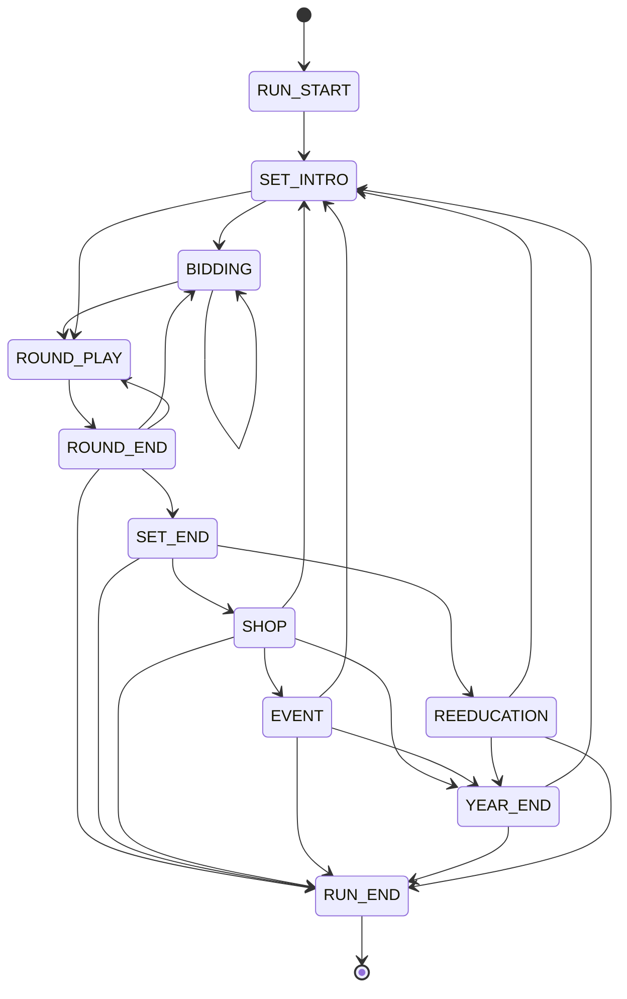

# Architecture

This file changes in the same commit as any architecture change. Decisions and their reasons are in [adr/](adr/).

## Layers

Dependencies run one way: `ui` → `game` → `core`. `core` may read definitions from `data`. Nothing in `core` references `game` or `ui`.

| Folder | Holds |
| --- | --- |
| `core/` | Pure logic: model, rules, modifiers, scoring, bots, run. No nodes, scenes, autoloads or I/O |
| `data/` | Resource definitions and the string table ([ADR 0006](adr/0006-string-table.md)) |
| `game/` | Controllers that bridge `core` to scenes |
| `ui/` | Scenes and themes |
| `art/`, `audio/`, `shaders/` | Assets |
| `tests/` | Unit, integration and golden tests |
| `tools/` | Asset scripts and headless harnesses |

`tools/layer_check.gd` enforces the `core/` rules, and the test suite runs it. It reads base types and global classes from Godot and separates code from strings. It scans `core/` and `data/`, so a data script cannot smuggle randomness in. It fails on a path outside `core/` and `data/`, a relative or `uid://` path, runtime `load()`, a Node subclass, a scene, a global class outside those folders, autoload or scene tree access, an engine singleton other than the math ones, a card setter outside `CardModifiers`, a global random function, array shuffle or pick by call, reference or name, access to `_rng`, `tr()`, runtime code evaluation, or an engine generator outside the stream service.

`tools/script_check.gd` makes every project script compile in the test suite, because exports tokenize scripts without type checking.

## Randomness

Each run has one `RandomStreams` with eight independent streams: deal, shop, debuff, ai, events, cosmetic, audit, names. A stream's seed is an FNV-1a hash of the run seed and its name, so adding a stream never disturbs the others. `core/` code takes a `RandomStream` and never touches an engine generator. Seeds and states serialize as text, because JSON numbers cannot hold 64 bits.

## Rules

`core/rules/` is the rules engine. Everything works on rank counts, so suits never affect legality.

| Piece | Job |
| --- | --- |
| `RuleSet` | Frozen legality parameters, built from a `RuleParams` Resource |
| `Pattern` | One play as ranks, with a comparison key fixed at construction, and the cards it spends when a wild card stands in |
| `Classifier` | Reads one Pattern from a count vector in O(15) ([ADR 0007](adr/0007-classifier-rules.md)) |
| `PlayComparator` | Decides whether one play beats another, by its reading |
| `MoveGenerator` | Lists every legal Pattern for a hand, and with wild cards every reading once |
| `CardSelection` | Maps a Pattern to card instances, and a player's picks back to a Pattern |
| `Bidding`, `LandlordSeat` | Call and grab, and who holds the seat across a Set |
| `RoundState` | One round. `apply()` is its only mutator, and it returns a reason code or emits `RoundEvent`s |

Patterns store base ranks. Only the comparison key uses the effective rank, so chains stay adjacent in base ranks whatever a modifier does to rank order. The round reads keys from each seat's standings (`SeatRules.standing_for`, [ADR 0039](adr/0039-cadres-work-for-the-household.md)), its order on a scale every seat shares, so plays of seats with different orders compare fairly; `same_reading` compares shape and main rank, so a pattern read on a seat's 0 to 14 order still matches the same play read on its standings. A chain is answered only at a length the follower's own rules allow.

### Wild ranks ([ADR 0029](adr/0029-wild-ranks.md))

While a rank is wild, a play is a reading of the cards it spends. A `Pattern`'s type and ranks are the reading, every card as the rank it stands for, and `Pattern.spent` holds the printed rank counts of the cards. `spent` is left empty when the two are the same, so a play with no stand-in compares, hashes and logs exactly as it did before wild ranks. `counts()` is the reading and `spent_counts()` the cards: comparison and the rank maps use the first, and everything that takes cards out of a hand, counts what has been seen or scores Grain uses the second. `same_reading()` ignores the cards and `equals()` does not.

| Piece | Job |
| --- | --- |
| `WildSupply` | Splits a hand into natural and wild cards and spends a reading from them: natural cards first, then wild cards at their own rank, then stand-ins from the wild rank held fewer of. Refuses a joker stand-in and a play of wild cards alone with none at its own rank |
| `Readings` | Every legal reading of one set of cards, strongest first, and `checked()`, which validates a named reading against the cards in O(15). Cards with no wild card among them still read through `Classifier` alone |
| `PlayPlacement` | The rank each physical card stands for, which decides body or kicker for scoring and is what the screen shows beside a stand-in |

- **Comparison.** Bombs order by size, then kind (pure-wild above natural above soft), then rank. Without bigger bombs every bomb has four cards, so the kinds decide; with them more cards win whatever the kind. Only four cards of a wild rank read as that rank are pure-wild, and whether the rank is wild is the playing seat's to say: the classifier and the generator set `Pattern.main_wild` from that seat's rules, and `PlayComparator.bomb_kind` reads it, so a villager's four of the player's wild rank are a natural bomb whoever compares them ([ADR 0039](adr/0039-cadres-work-for-the-household.md)). The rocket beats every bomb; with `rocket_above_wild_bomb` off, the pure-wild bomb sits above the rocket and the rocket above every other bomb.
- **Generation.** `MoveGenerator` lists every reading a hand can make once, spent the way `WildSupply` spends it. It does not list every other way to spend the same reading. A kicker made of wild cards alone reads as one rank, the wild card's own where that is allowed, so readings that differ only in such a kicker are not repeated. Lean generation (`generate(..., lean = true)`, `WildSupply.is_lean`) also leaves out a wild card standing in for a kicker and a four-with-two whose four needs a stand-in; bots and rollouts use it, the round never does. A test holds lean generation to a median under 10 ms and complete generation under 25 ms on 20-card hands with one wild rank (measured 2.5 and 4.9 ms on the development machine).
- **The round.** `RoundAction.reading` names a play's reading. `RoundState.read_play` fills `PlayReading.readings` with those playable now, strongest first; an action that names none plays the strongest. `action_for` always names the bot's reading. The round's wild ranks live in `RunState.wild_ranks` (at most two), reach the player's seat's rules alone through `SeatRules.set_wild_ranks(ranks, PLAYER)` when `RunLoop` creates the round, and are cleared when it ends. Every item that makes a rank wild is the player's (ADR 0039); `set_wild_ranks(ranks)` with no seat makes them every seat's, as the tournament's `--wild`, `tools/expert_play.gd` and tests do.
- **Where a rank comes from.** `RunWild` (`core/run/`) draws a rank from 3 to 2 that is not wild yet, on the deal stream, while fewer than two are wild. Mass Line's is drawn in `RunLoop._deal_cards` after the deal, so the deal is unchanged and the rank is named before the bid; a redeal clears it and draws again. Model Worker's is drawn when the Campaign is used, before the first play, and changes the player's rules at once (`SeatRules.set_wild_ranks`, then `refresh()`). Each draw is a `WILD_RANKS` run event: its value is the rank and its text every rank wild now, in the order drawn.
- **A Reform's rule.** A Reform may give the player's seat a rule: `ReformEffect.rule_hooks()` names its hooks and `table_rule()` gives the effect. `RunReforms.table_rules(state, holder)` builds each as a stack entry of kind `REFORM` held by the player, in code, and `RunLoop._rebuild_modifiers` adds them after the Cadres; `SeatScope` gives a Reform's rule hooks the holder's seat alone (ADR 0039). The entry is not in the inventory, so nothing that takes a Cadre takes it. Industrialization's is `BigBombsRule` (`core/reforms/`): `five_plus_is_bomb` for the player's seat through the ruleset hook, and Zeal for each card past the fourth in a bomb, for whoever plays one, which only the player can. A villager answers the player's bomb of five or more with the Rocket alone: the comparison key holds the card count, so a bomb of four never beats it, and the round, the generator and every bot read that one comparator. The tournament's `--big-bombs` sets the rule in every seat's base parameters instead.
- **The screen.** `TableWild` (`ui/table2d/`) acts on events alone. A `WILD_RANKS` event shows a call-out, and gives the ranks to `DebuffStrip`, `HandView` and `TrickPile`; a new deal clears them. The rules slip names the wild ranks on its first line, as the player's, and lists a Reform's rule under the player's Reforms. Only the player's cards of a wild rank wear the ribbon: `TrickPile.show_play(..., wild)` is false for a villager's play and for a kitty that goes to a villager, so their cards land plain, and their readings have no stand-in to label. `WildRibbon` (`ui/cards/`) is the mark on a wild card, drawn in code and worn by `BowlGrime.wear()`, so it is grimy at stage 0 and worse at each stage. A stand-in on the pile carries a rank note from `PlayPlacement.stands_for`. `TableCommands` opens `ReadingPicker` only when `RunController.readings_for` gives more than one reading; the slip takes every key while open, and `ReadingText` puts each reading in words. `HandModel.take_hint()` keeps the hint's reading while the selection is still the hint's cards on the same turn, so Play sends that reading without asking, and `preview_play(ids, reading)` previews it. `CheatSheet` gains a section while a rank is wild and lists a Reform's table rule with the rules in play; a sheet taller than the screen is drawn smaller, never cut off (`_fit`, after each layout). The event sounds as `store_buy`.
- **Scoring.** Grain comes from the cards as printed, Rate from the reading's type, and body or kicker from `PlayPlacement` (`Scorer.body_flags`). `PlayContext.kicker_cards` gives effects the kickers' own printed ranks.
- **The record.** A `play` command and a written Expert decision keep `reading` only when the cards could be played more than one way (`ReadingCodec`, which also validates it and the saved wild ranks).

### Information boundary

A bot receives a `SeatView` and nothing else: a `PublicView` plus copies of its own hand. Every field of a view is an independent copy with no link back to the round, so a bot can neither reach another seat's hand nor change the round by editing what it holds. A test walks every object reachable from a `SeatView`, and another edits a view and checks the round is unchanged. The round copies the hands it is given and never hands out a `Hand`; `action_for()` turns a Pattern into an action on the controller side.

## Bots

`core/bots/` holds the bots. `Bot` is the only way the game asks for a decision, and a test fails if `core/`, `game/` or `ui/` reaches past it. Bots stay pure: a `BotBudget` carries an injected clock, worker threads live in `game/bots/`, and a `BotRationale` code replaces debug text, whose words live in `tools/` so they never ship ([ADR 0009](adr/0009-bots-and-the-core-boundary.md)).

`HandDecomposer` finds the fewest plays that empty a hand: a memoized search over chains, with a closed-form count for the rest in `DecompositionLeaf`. One instance serves one decision, so all its candidates share the memo. Quads stay bombs unless a chain takes from them, and trios stay whole, so its optimum is over those groups, not over every legal play. Four-with-two is left out for the same reason.

`UnseenCards` counts what a seat has not seen, from its view alone. `Controls` flags the groups no unseen combination can beat, so effective hands are hands less controls.

A `BotTable` is the deciding seat's rules, order and standings. Made with `BotTable.of_seat` from the round's `SeatRules`, as the run, `SelfPlay` and Campaigns make it, it also holds every other seat's, before and after a bomb in the trick ([ADR 0039](adr/0039-cadres-work-for-the-household.md)): `Rollout` decides each seat under its own (`as_seat`) and turns orders over when a bomb lands, `Controls` reads an answer under each rival's rules and standings (`BotPosition.rivals`, empty while every opponent plays as the bot does), and a bomb's under the bot's and each rival's as they stand once a bomb is down (`BombedSide`), and `BotPosition.outranked` compares an opponent's rank with the bot's own on the shared standings. A table made from one seat's rules alone plays every seat so, as the tournament's does.

`CandidateScorer` values a candidate by the hand it leaves, from a `BotWeights` Resource, and scores each move once a decision. `SelfPlay` plays bots against each other through the real `RoundState`, so every harness measures the rules the game uses.

`BotPosition` works out what one decision knows, once, from the seat's view. `LeadPolicy` applies the lead rules in priority order on top of it, `FollowPolicy` the follow rules and their gates, and `SeatRole` what differs between the upstream and downstream peasants. `BidPolicy` weighs hand points against a threshold from data.

Under wild ranks ([ADR 0029](adr/0029-wild-ranks.md)) every tier chooses from `Bot.considered(legal)`, the legal moves less the ones lean generation leaves out. `HandDecomposer` holds the hand's wild cards as a budget: a chain may take one where a rank is one card short, and `WildLeaf` places the rest in closed form (the lowest pair to a trio, else the lowest single to a pair, else the highest trio to a bomb, else its own rank), weighing all of them at their own rank too, so four of a wild rank can stay a pure-wild bomb. A plan's groups are readings, matched to legal moves by `same_reading`. `BotPosition.could_hold` and `Controls` count unseen wild cards toward what an opponent could answer with, and never treat a lone wild card as a stand-in single. `BidPolicy` adds `BotWeights.wild_card_points` for each wild card held.

`BotConfig` picks a tier. Easy is `GreedyPolicy`. Medium is the policies above with 2s and jokers as controls. Hard adds card counting, endgame blocking and seat roles, and plays by rules alone. Expert searches every decision. `ExpertSearch` deals the unseen cards consistently with what is public and plays each top candidate out with `Rollout`, a fast count-based simulator of the Medium policy. A `BotSearchJob` holds that work, so `ExpertRunner` in `game/bots/` can spread it over the worker pool. A search only chooses among the policy's own play, a pass and the moves its gates leave open, so it never reopens a gate. A rival must beat the policy's play by a margin, so noise can't overturn it. At the deadline the job decides on the samples it finished, and with too few the policy decision stands. `BotConfig.searches()` says whether a tier searches. In the live game the deadline is `BotWeights.expert_deadline_usec` (300 ms): no sample starts after it, and one still running `expert_grace_usec` (60 ms) later is abandoned between two rollout steps, through a `BotBudget` the runner hands each sample. The search runs off the thread that handles the player's command ([ADR 0030](adr/0030-searched-decisions.md) and its P5.0 amendment): the loop stands still for a searching villager (`RunLoop.Awaiting.VILLAGER_SEARCH`) and hands out a `SearchRequest` of copies, `ExpertRunner.start` runs the decision on the worker pool and is polled, and the play goes back through `RunLoop.villager_play`. Outside the tree `RunController` searches at once with the blocking `ExpertRunner.decide`, which is also the loop's searcher when nothing answers from outside. Tests, the tournament and the balance harness give the loop no searcher (`RunController.live_search = false`), so a searching seat searches with no limit and stays repeatable. Tier strength is measured as in [ADR 0010](adr/0010-measuring-tiers.md), and [ADR 0011](adr/0011-tier-strength-bar.md) records the tier bars and why Expert's is low.

A `Personality` Resource holds a tier and five levels. `PersonalityTable` turns levels into numbers, and `BotConfig.from_personality()` applies them.

## Modifiers

Every Cadre, Campaign, Directive, Reform, debuff and boss twist is a `ModifierDef` Resource in `data/modifiers/`. Its behavior is a small `ModifierEffect` script registered by ID in `EffectRegistry`. `ModifierValidator` checks each definition against the hook list, its effect and the string table.

`ModifierStack` runs hooks in one order: active Cadres in slot order left to right, then active debuffs in ladder order, then the boss twist. `SeatRules` caches one RuleSet, one effective-rank map (the seat's order, 0 to 14) and one set of standings per seat, the maps for each side of a bomb in the trick, rebuilt behind a dirty flag when a modifier changes or a round starts, or when a bomb changes the trick's state. Standings (`Standing`) start printed ranks `Standing.STEP` apart, the lowest one `Standing.FLOOR` up so there is a gap below it as well as above the highest, and run the same rank hooks with `RankMapContext.step` set, so `RankShift` drops a moved rank into a gap and `ReversedRanks` turns over about `Standing.TURN`, the same middle, a rank above the top landing below the bottom and every value staying in a byte; a seat's order and standings always agree. `RoundState` calls `refresh()` before each action, and queries never rebuild. A modifier runs only on the hooks its definition lists. [ADR 0008](adr/0008-rank-modifiers.md) has the rank rules.

**Whose seat a modifier acts for** ([ADR 0039](adr/0039-cadres-work-for-the-household.md)). A Cadre works for the household that holds it. `SeatScope` says so once: a Cadre's `build_ruleset` and `build_rank_map` reach its holder's seat alone, and its `play_scored` and `card_scored` reach its holder's plays, and the teammate's while the holder is a peasant when the definition sets `counts_for_teammate` (only a collective Cadre with a scoring hook may). `ActiveModifier` reads its reach once from its definition, and the stack skips an entry whose reach leaves out the context's seat, so no effect carries a guard of its own for it. A Reform's rule hooks reach its holder's seat alone too (the second note of 2026-11-24 in ADR 0039: whatever the player buys that changes how the game is played acts for the player's seat), and its scoring hooks score whatever play that rule allows. Debuffs and boss twists reach every seat and keep whatever seat test their effects make. Wild ranks are not a modifier: `RunLoop` sets them for the player's seat in `SeatRules`, and `Controls.threat_rules` makes a bot count unseen wild cards only under an opponent's rules that hold them. `CardContext.landlord`, like `PlayContext.landlord`, tells the stack the seat's side; outside a round nobody has a teammate. A seatless hook that pays the peasants (The Gleaners) asks `SeatScope.is_peasant` of its holder.

Each hook takes one typed context:

| Hook | Context | Fields |
| --- | --- | --- |
| `build_ruleset` | `RulesetContext` | seat, landlord, params |
| `build_rank_map` | `RankMapContext` | seat, landlord, trick_bombed, rank_map |
| `on_deal` | `DealContext` | landlord, deal |
| `round_start` | `RoundContext` | landlord, round_state, table, stream, arrived, swap_cap, seize_plot, moves |
| `play_scored` | `PlayContext` | seat, is_landlord, landlord, pattern, cards_left, seat_plays, seat_grain, add_grain, add_zeal, mul_zeal, rate_percent, rate_cap, total_scale, year, body_cards, stamps_resented |
| `card_scored` | `CardContext` | seat, is_landlord, card, own_grain, grain, printed_grain |
| `turn_taken` | `TurnContext` | seat, landlord, pattern (null for a pass), cards_left, player, resentment, coupons |
| `trick_won` | `TrickContext` | winner, landlord |
| `round_end` | `RoundContext` | landlord, winner, finish, commons_scale, bank_voided, tax_percent, meter_sources, landlord_cards, famine_fall |
| `set_end` | `SetContext` | set_index, target_met, coupons, add_coupons, over_steps, add_resentment |
| `shop_open` | `ShopContext` | seat, cadre_cut, free_market_rerolls |
| `meter_change` | `MeterContext` | meter, delta |
| `audit` | `AuditContext` | faces |
| `need_settled` | `NeedContext` | player, landlord, declared, true_need, caught, resentment_fall, coupons |

`need_settled` runs once a round's Commons is split and its audit is done ([ADR 0032](adr/0032-second-content-wave.md)): it is the only place an effect learns what the player declared against the true need and whose lies the audit caught.

**Falls.** A meter or Resentment comes down through one path each: `RunMeters.lower` and `Resentment.lower`. Both stop at 0 and log the same event a rise does, with a negative value. A meter that falls back below a band re-arms that band's setback by the meter table's margin, and a fall below the rationing line lifts rationing. Public Granary lowers Famine through `RoundContext.famine_fall`, before the round is scored, so a Quota's report still counts only its own rises; Campaigns lower through `CampaignContext.relent()` and `move_meter()`. The amounts are the items' own parameters, under the meter rows `cadre_famine` and `campaign_denunciation`.

## Scoring

`Scorer` scores a play as Grain × Rate × Zeal from the `ScoreParams` Resource ([ADR 0020](adr/0020-grain-rate-zeal.md)). Grain is the scored cards' rank values (3 to 17) plus the hooks' additive Grain. Rate comes only from the hand type and its level (`hand_rate`), under any Rate cap a hook sets. Zeal starts at 1, takes each scored Pennant card's `pennant_zeal`, then changes through hooks, additive then multiplicative, never below `min_zeal`. A hook's `total_scale` multiplies the finished total. `ScoreBreakdown` holds the ordered steps for the UI in one flat array. A real play also records its `trail` (P5.2a): `ScoreTrail` is handed to `ModifierStack.run_card_scored` and `run_play_scored`, which tell it after each hook, and it compares the context with what it saw last, so no effect script knows of it. Each `ScoreStep` is plain data: the figure it moved (Grain, Rate, Zeal or the total), whether it adds, multiplies or sets, the figure before and after, and what made it (a card's printed Grain, the hand's Rate, Zeal's start, the hand's level, a card's mark, or a modifier by ID and kind, with the card it scored on). A fifth figure, `COUPONS`, is what a Surplus card paid the player ([ADR 0041](adr/0041-marks-on-deck-cards.md)): `RunLoop` adds those steps after the score through `SurplusPay`, and they change no other figure. The steps run cards first, then Rate, Zeal and the level, then each card's mark and card hooks, then each play hook in the order it ran; each figure's steps follow the scorer's own formula over the hooks so far, so applied in order they give the play's figures and total. `RoundScoring` records for real plays only, never a preview, and `RunLoop` puts the steps on every seat's `PLAY_SCORED` (`RunEvent.steps`, never saved). `tests/unit/test_score_steps.gd` holds that recording changes no score under any modifier and that the steps add up. `HandLevels` tracks each hand type's level, which raises its Rate, and `ScoreFormat` writes short-scale numbers and one-decimal multipliers. Modifier parameters are integers, so Zeal amounts are stored in hundredths under `zeal_percent` names, and `ModifierDef.text_values()` writes them as decimals in rules text. `Banking` converts scores to whole pool units, rounding down, and splits the pool by need.

Card enhancements, seals and stamps change only through `CardModifiers`, and the layer check rejects their setters anywhere else in `core/` or `data/`.

## Run

`core/run/` holds the run. `RunState` is everything a run needs to resume: the seed and stream states, the Year, Set and round, the debuff ladder, both meters, the roster as `RosterEntry` rows, the player's `RunInventory` (Cadres in slot order, consumables, the private plot), coupons, the Commons pool, the landlord seat, the family in each seat, and one `SetSummary` per Set, the current Set's last. It serializes to a Dictionary of JSON-safe values, with numbers that can pass 2^53 as text.

`RunFlow` holds the run's states and the one table of moves between them; any other move returns a reason code and changes nothing. `RunState.phase` records where the run stands. A test checks this diagram against the table.

Bidding loops on itself for a redeal. A round goes back to bidding when the landlord lost, and straight to play when the seat is kept. Reeducation (P4.1) replaces a Set's shop visit, and the run can end wherever a meter moves.

**Meters (P4.1).** `data/run/meters.tres` is a `MeterTable`:

- `MeterBands` for each meter: the low, mid, high and death thresholds, plus a re-arm margin.
- One `MeterSource` row per cause of change: missed target, Commons shortfall, private purchase, caught lie, and a band-sized row for each meter's debuffs.
- The store slots that rationing cuts.

`RunMeters.apply(source)` handles every change:

1. It runs the change through the `meter_change` hook and clamps the result.
2. It logs `METER_CHANGED`.
3. It fires the mid-band setback once per upward crossing. The flags for this live in `RunState`. A setback re-arms only after the meter falls below mid minus the margin.

The two setbacks:

- **Rationing** holds while Famine stays up. `RunShop.slot_count()` cuts the store's slots for as long as it lasts.
- **Reeducation** is owed once. `open_shop()` serves it in place of the store: the run moves to `REEDUCATION`, the plot is emptied, and one held Cadre is exchanged ([ADR 0019](adr/0019-reeducation-setback.md)).

Death is checked after each meter move, at a state that may go to `RUN_END`: Set end, or round end for a shortfall. The run log gets `RUN_DIED`, naming the meter. A save is stamped with the content it was written against, the game's version and a hash of every pool a run draws by slot (`ContentStamp`, kept beside the data under the seal). A save whose stamp is not this build's, or whose commands no longer apply, resumes at its checkpoint with the commands since left out: the start of its Quota, or its end for a save made in the shops ([ADR 0033](adr/0033-saves-across-content-changes.md)). Run saves are schema 18 (`RunRecord.migrate_from_17` adds `reported_steps`, none: the norm steps False Report raised during the Quota in play, which count from the next one, [ADR 0032](adr/0032-second-content-wave.md); `RunRecord.migrate_from_16` adds the run's books, empty, and the file's entries at the run's start, none, [ADR 0022](adr/0022-the-file-and-unofficial-builds.md); `RunRecord.migrate_from_15` adds the round's wild ranks, none, [ADR 0029](adr/0029-wild-ranks.md); `RunRecord.migrate_from_14` names a saved full run from its seed and generation and gives it no drift, [ADR 0028](adr/0028-names-and-generations.md); `RunRecord.migrate_from_13` starts the count of Quotas without the landlord's seat at zero, [ADR 0031](adr/0031-the-unheld-seat.md); `RunRecord.migrate_from_12` marks an older save as holding no written decisions, [ADR 0030](adr/0030-searched-decisions.md); `RunRecord.migrate_from_11` added the Quota's corruption events and the famine purchase count; `RunRecord.migrate_from_10` added the run's identity and the Year's starvation count; `RunRecord.migrate_from_9` added the final Year's class counters; `RunRecord.migrate_from_8` added the Slogan's hand type; `RunRecord.migrate_from_7` added the Reforms and the gathered deck; `RunRecord.migrate_from_6` added the Cadres' run state; `RunRecord.migrate_from_5` added card marks and hand levels, and `RunRecord.migrate_from_4` added the norm, both P4.11; `RunRecord.migrate_from_3` added `store_sold`, P4.10); `RunRecord.migrate_from_2` added the setback flags and Resentment for schema 3.

**The unheld seat ([ADR 0031](adr/0031-the-unheld-seat.md)).** `RunState.seatless_sets` (schema 14) counts the Quotas in a row the player ended without holding the landlord's seat in any round; `YearClass.held_seat` reads that from the Quota's `SEAT_KEPT` and `SEAT_LOST` events. At each Quota's end, after starvation, reeducation, and the styles and risen villagers are recorded, and before Resentment is counted, `RunLoop._count_standing_by` sets the count to zero when the player held the seat, and otherwise adds one. Past `RunParams.seat_grace_sets` (3 in `data/run/default_run.tres`) each such Quota costs steps, one more each Quota up to `seat_max_steps` (4), and Famine rises by the steps times the meter table's `stood_by` row (1), through `RunMeters.apply_amount` and so the meter change hook. The loop logs `STOOD_BY` on the last free Quota (value 0) and on every Quota that pays (value the steps, amount the Famine it added), and the Quota summary says what it cost or warns from that event and the count in its state copy.

**Names and generations ([ADR 0028](adr/0028-names-and-generations.md)).** `RunNames` (`core/run/`, in `RunState.names`, schema 15) holds a full run's given names: the player's and every roster family's, drawn as the run starts by `RunStarter`, and each sent-down youth's as `Roster._spawn_youth` brings them in. The draws are on the run's `names` stream alone, so naming moves no other draw. The pools, the blocked names, the offered surnames and the fallback surname are data: `NameBook` and `NamePool` in `data/villagers/names.tres`, generated from the ADR's lists, and `tests/unit/test_name_book.gd` reads the ADR again and fails where the two differ. A draw filters the generation's pool to the names nobody in the run holds and that are not blocked with the surname, then takes one; a pool with none left hands on to the next. Surnames are string keys, so `RunStarter` passes each key's text (`Surnames.texts`) and core compares them as they read. A youth never takes a surname that reads as the player's. The demo and the arrival name nobody and keep only the player's surname.

`VillageDrift` (`core/run/`) is how far each village family has moved from its definition: an offset in steps for each of the five personality levels and a shift of the voice's pitch. It lives in `ProfileData.drift`. `ProfileCommits.start_run` moves it on in the same write that raises the generation (`VillageDrift.next`, on a stream seeded by the generation number, from generation 2), and copies it into `RunState.drift`, so a saved run keeps the village it started with. The three numbers are on `VillageBook` (`drift_chance`, `pitch_step`, `pitch_limit`). `Roster.config_for` plays a family by a drifted copy of its personality; the shared Resources never change, and youth never drift. Voice banks are rendered ahead of time, so the pitch shift is applied at playback: `RunPeople.seat_voice` hands out a copy of the voice with `VoiceProfile.playback_pitch` set, which is never saved, and `VoiceScript` scales by it. A run started without a profile takes its surname and generation from the `RunRequest` and has no drift.

`game/run/surnames.gd` is what the surname field accepts and refuses, and `game/run/run_people.gd` gives pages the names: `RunController.seated_full_name`, `player_name` and `seated_voice`. The dossier, the Quota page's "At the table" line, run setup and the ending page print full names; the table, speech, the epilogue and the history use the surname alone.

**Resentment (P4.2).** `RunState.resentment` runs from 0 to 100. `Resentment` and `data/run/resentment.tres` define what raises it:

- each black market purchase, a Cadre or a plot upgrade (`RunLoop.player_market_buy`, `player_upgrade`);
- each private Cadre held at a Set's end;
- each card the player scores that carries their own stamp.

Resentment acts in two ways:

- **Denunciation.** At each Set's end, Denunciation rises by `denunciation.sample(resentment / max)`, through the meter table's `resentment` row. That curve is the only mapping from Resentment to Denunciation.
- **Grudge.** At each round's start, every bot's `memory[player]` is set to `grudge(resentment)`. A bot's spite (grudge × memory) is added to every answer it scores. It also divides its cooperation, so a resented player's teammate covers for them less often.

**Declared need (P4.3).**
- **Declaring.** Every peasant declares a need before the split. Bots lie as their honesty says, and the player may declare any value.
- **Auditing.** `NeedAudit` then checks each declaration on its own `audit` stream. Each declaring seat rolls one die (`audit.tres`: six sides), and a face at or below the audit faces means its claim is checked. The faces are the base of one, plus one while an informer family is seated or active on the roster, then whatever the `audit` hook adds, capped at `max_faces` so a check is never certain. Every seat rolls once, so the stream moves the same whether anyone lied or not. Each roll is logged as `AUDIT_ROLLED` with the face shown, before any `AUDITED`, and the table plays it as two dice in a bowl (`DiceBowl`), so the chance the need panel shows is the die's ([ADR 0021](adr/0021-starter-content-set.md)).
- **Overfulfilment and the norm.** At a met Set's end `RunLoop._overfulfil` counts one step for each full `over_step_percent` the Set beat its target by, up to `over_max_steps` (`SetParams`). Each step pays a coupon, adds Resentment and adds to `RunState.norm_steps`, logged as `OVERFULFILLED`. `RunLoop.target()` is the curve's target, then any boss's change, then the norm: `norm_percent_per_step` for every step earned in earlier Sets. `RunState.over_steps` holds the finished Set's own steps until the next Set starts, so the Quota report still reads the target that Set was played against.
- **Marks on cards.** A card's stamp and its one enhancement are drawn on its left edge, under its index, where a fanned hand still shows them (`ui/cards/card_mark.gd`, one shape per mark). The deck is built new for every deal, so `CardMarks` (`core/run/card_marks.gd`, saved in `RunState.card_marks`) keeps each deck card's owner stamp and enhancement by card ID, and `RunLoop._deal_cards` puts them back through `CardModifiers`. A plot card carries its own marks, saved with the plot; in a hand it is a copy, and `CardMarks` marks the plot's card through it by ID. A deck card a swap sets aside keeps its saved marks for the next deal. `CardMarks.stamp` and `CardMarks.enhance` are the only ways to mark a card for the run; a new enhancement replaces the old. The enhancements are `CardInstance.ENHANCEMENTS` ([ADR 0041](adr/0041-marks-on-deck-cards.md)), each a scoring effect for whoever scores the card, never as a kicker: Model scores `model_grain_percent` of its Grain and a Sheaf `sheaf_grain` more (`Scorer.marked_grain`, before any hook runs), a Pennant gives its play `pennant_zeal`, and a Surplus card pays the player `surplus_coupons` up to `surplus_round_most` a round (`SurplusPay`), a villager nothing. `MarkCardsEffect` is every Campaign that marks cards in hand, given the mark it makes. The deck sheet (`DeckSheet`, `DeckBoard`, `DeckFit` in `ui/screens/`) shows every deck card and the plot's as real faces with their marks, a rank to a group, from `RunController.deck_cards()`; it opens from a Deck button in both shops and from the table's menu (`TableDeck`).
- **Hand levels and Directives.** Each hand type's level is saved in `RunState.hand_levels`, and the loop scores with it. A `DirectiveDef` (`data/modifiers/directives/`, pooled in `data/run/directive_pool.tres`) names the hand types it raises. The state store draws `directive_slots` of them on the shop stream after every other shop draw, leaving out a family already at the top level, and a reroll redraws them. Buying one is the `directive` command (`RunLoop.player_directive`): it costs its price and raises each of its types one level at once. `ModifierDef` and `DirectiveDef` carry an `unlock_tier` that nothing reads until P4.14.
- **Campaigns.** A `CampaignDef` (`data/modifiers/campaigns/`) is a one-use item held in `RunInventory.consumables`, up to `campaign_slots`. Its behaviour is a `CampaignEffect` in `core/campaigns/effects/`, registered by ID in `CampaignRegistry`. Each shop draws `campaign_offers` from its own pool (`CampaignCounter`) at the very end of `open_shop()`, and a reroll redraws them. Two saved commands drive them: `campaign_buy`, and `campaign` (the held slot and the chosen card IDs, `RunLoop.player_campaign`). A refused use changes nothing; `campaign_reason` gives the code the UI explains.
  - **When.** Most are used on the player's turn. Mutual Aid and Appeal need a moment before the landlord's first play, which a peasant never has, so the loop stops at `Awaiting.PLAYER_OPENING`, after the plot swap, only while a peasant holds a Campaign usable there. The `begin` command ends the wait. It sits inside the round's play state, so the run-state table is unchanged.
  - **Round effects** (the doubled-or-nothing stake, the forced pass, the lifted debuff) live in `CampaignRound`, reset at each round's start and end and rebuilt by replaying the Set's commands, so nothing is added to the save.
  - **Hands.** `RoundState.trade()` swaps cards one for one between two seats mid-round and `RoundState.mark()` marks a live card. A kitty card that leaves the landlord's hand is dropped from the public kitty, because the Expert bot deals the unplayed kitty to the landlord when it samples hands. Bots never use Campaigns; `AidChoice` picks what a teammate gives in Mutual Aid.
  - **Meters.** Grain Loan's Famine goes through the `campaign_famine` row. In a shop a death ends the run at once; at the table it is found at the round's end, where every round already checks.
- **Reforms.** A `ReformDef` (`data/modifiers/reforms/`, pooled in `data/run/reform_pool.tres`) is a permanent upgrade, held as an ID in `RunState.reforms` for the rest of the run. Its behaviour is a `ReformEffect` in `core/reforms/effects/`, registered by ID in `ReformRegistry`. An effect changes nothing itself: it answers a question from its parameters.
  - **One reader.** `RunReforms` (`core/run/`) is the only place the run asks those questions: `cadre_slots`, `campaign_slots`, `quota_coupons`, `missed_famine`, `extra_envelope_choices`, `gathers_deck`, `wild_ranks_per_round` and `table_rules` ([ADR 0029](adr/0029-wild-ranks.md)). Both shops, the controller and both boards take the player's limits from it, starting from the state store's `ShopParams`; the black market's own `cadre_slots` and `campaign_slots` are not read.
  - **The offer.** `ReformCounter` draws `reform_offers` (state store 1, black market 0) last of all in `open_shop()`, after the Campaigns, so a Reform changes no stock drawn before it. It never offers one that is held, or one whose `held_back` flag is set (none is, today). A reroll redraws it. The saved command is `reform` (`RunLoop.player_reform`).
  - **Unplanned Economy** deals without a shuffle between the rounds of a Quota. At a round's end `DeckOrder.gather` takes the cards in the order they were played, then each seat's unplayed cards in seat order, then the unplayed kitty, into `RunState.deck_order`. The next deal cuts that order once on the deal stream and deals it in blocks through `Dealer.deal_in_order`, so cards played together tend to land in one hand. The order is cleared at a Set's start and end and before a redeal, so a Quota's first round and every redeal are shuffled. A deck card a swap set aside goes back at the end of the order, and a plot card is left out. Measured over about 3,000 deals each way, it raises four-of-a-kinds from 0.29 to 1.32 a deal, for every seat; P4.16 tunes it.
  - **Grain Reserve** takes its relief off the missed Quota's Famine before the meter-change hook runs.
- **The arrival** ([ADR 0026](adr/0026-tutorial.md)) is a third kind of run, `RunIdentity.Kind.TUTORIAL`, started with no save service and no profile, so it writes neither.
  - **Authored.** `data/run/tutorial/arrival.tres` (`TutorialScript`) holds the seed, each round's 54 cards in deal order, the villagers' bids, moves and claims, the dice faces to show, and the steps. `RunTutorial` (`core/run/`) deals each round through `Dealer.deal_in_order` and hands each villager a `ScriptedVillager` on its `BotConfig`; `Bot` answers from that script first, so it stays the only way the game asks for a decision. An authored move that is not legal is logged, counted in `refused_bot_actions`, and replaced by a legal one. `AuditParams.shown_faces` carries the authored dice and `PlotUpgradeParams.card_suits` the stall's card.
  - **Steps.** `TutorialDirector` (`game/run/`) walks the steps. Screens ask `app.arrival.allows(...)` before acting; with no arrival running everything is allowed. A wrong action changes nothing and the slip pulses. A follow-up to an action at the table waits until `TableTutorial` reports that the run's answer has played and the top play's cards have landed, or that a new deal has begun (`TutorialDirector.answered`). `TutorialLayer` (`ui/tutorial/`) draws Wang's slip, the light on the target (`TutorialGlow`: a gilt frame with a breathing halo on the button or card itself, still under reduced motion), and Skip. It shows nothing of the dread board or the hidden corruption: the arrival teaches how to play and nothing else.
  - **Offer.** `Arrival` reads whether a profile save exists once, when the app starts. With none, the content note leads to the surname page (`ui/screens/surname_screen.gd`, [ADR 0028](adr/0028-names-and-generations.md)), which writes nothing and hands the surname to `Arrival`, and then to the Arrival page. Finishing or skipping writes the profile's first save with the tutorial marked seen and that surname, in one write (`ProfileSeen.arrive`); quitting part-way writes nothing. Once the profile has finished or skipped it, the title offers Replay the arrival, which plays it again without a save and ends at the title.
  - **One-time tips** (`TipSlip`) for the private plot, debuffs and villager memory show once per profile in full runs, through the profile's `seen` list.
- **The balance harness** ([ADR 0027](adr/0027-balance-harness.md)) is `tools/balance*.gd`, never shipped. `BalanceDriver` plays a full run through `RunController` by answering whatever the loop awaits, with the Hard bot playing the player's cards and one of three strategies making every other choice. Any refused command, refused bot action or logged error fails the run (`BalanceErrors` is a per-thread `Logger`). Seeds run in parallel on worker threads, and rows are identical for a seed whatever the job count. It writes `reports/balance_runs.csv`, `reports/balance_quotas.csv` (one row per Quota played, from `BalanceLedger`) and `reports/balance.md`, which `BalanceCurve` extends with a table per strategy by Quota and where coupons come from and go. `--expert-samples N` gives Expert villagers a per-run copy of the weights that samples N deals (12 at least), never the shared Resource. The driver uses Relief Grain once Famine is at least `relief_famine_at` and Self-Criticism once Resentment is at least `criticism_resentment_at`, never when its Denunciation would end the run (`tools/balance_wave.gd`), and a second closing line counts the second wave's pieces bought and used and the runs that reached The Commons. Under a wild rank the driver sends the bot's own reading with its play, and the harness prints one closing line with the wild items bought, the Model Workers used and the ranks drawn; the CSVs do not change. It runs in the nightly workflow.
- **What a run starts with** ([ADR 0025](adr/0025-meta-progression.md)).
  - **Pools.** `RunPools` (`core/run/`) is built once from the run's identity when the loop is built, so a loaded save rebuilds it. It is the one place the unlock filter and the stake's numbers are applied. `RunUnlocks` keeps only items whose `unlock_tier` is at or below the finished runs the run started with: both counters' Cadres, Directives, Campaigns, Reforms, the envelope kinds on offer and so their contents, and the Cadre reeducation gives in exchange. The tiers run from 0 to `RunUnlocks.LAST_TIER` (5, open after five finished runs, [ADR 0032](adr/0032-second-content-wave.md)). A run outside the profile, such as the demo, has every tier open below `RunUnlocks.WILD_TIER` (4), so the demo and the tests' default runs stay as they were built ([ADR 0029](adr/0029-wild-ranks.md)); the balance harness starts a full run with every tier open. Lookups by ID still see every definition, and debuffs are not filtered.
  - **Stakes.** `StakeDef`s (`data/run/stakes/`) carry only numbers, and `RunStakes.total` sums a stake with every lower one. Each number is a per-run copy, never a change to a shared Resource: the Quota targets (`SetConfig.under_stake`), the state store's slots, the audit's base faces (both the chance shown and the roll read the run's copy, under the cap), the ladder's budgets, and the starting meters. Winning a full run at the top unlocked stake unlocks the next, once, in `ProfileCommits`.
  - **Households.** A `HouseholdDef` (`data/run/households/`) sets coupons, plot cards, a starting Cadre, Resentment, Denunciation and Famine, applied by `RunOpening` before the first checkpoint without firing a setback. A locked or unknown household makes the start refuse.
  - **Lineage.** `RunLineage.left_by` works out what a finished run leaves (an heirloom drawn on a stream from that run's seed, one or two loyal families, the label, or nothing), and `ProfileCommits` writes it with the run's record. The next full run takes it at its start in the same write that bumps the generation, so it is used once. Starting amounts from household, lineage and stake add up.
  - **Order.** `RunStarter`: memory carried in, the generation and lineage taken from the profile, the village's drift for that generation, the roster with the families the profile has unlocked (thresholds on `FamilyDef`; Deng by the profile's count of landlord endings), everyone's given names, then lineage, household and stake.
- **Who a run is, and who it loses** ([ADR 0025](adr/0025-meta-progression.md)).
  - **Identity.** `RunState.identity` (`RunIdentity`, schema 11) holds the run's ID (seed and start time), its kind (full or demo), household, stake, the count of finished runs it started with and its generation. Continue rebuilds the saved kind from it.
  - **Starvation.** `VillageFates.starve` runs at a Quota's end: with Famine in its high band, and at most `starvations_per_year` times a Year, the seated family fed least at the Commons split that Quota dies, the later seat on a tie, never a boss. It is dead for the rest of the run (`STARVED`).
  - **Deposing.** A met Quota against a risen-villager boss deposes that family until the next Year starts (`DEPOSED`); the boss pool already never offers it twice.
  - **Denouncing.** The family an Anonymous Letter forces to pass (`PASS_FORCED`) is denounced by the player, which is what fills the memory's `DENOUNCED` count.
  - **Loyalty.** `VillageMemory.warmth` mirrors `pull` for a negative grudge. The player's teammate gets `BotConfig.loyalty` = warmth × `MemoryParams.loyal_cooperation`, added to its cooperation and capped; an opponent gets none.
- **Corruption** ([ADR 0018](adr/0018-horror-escalates-over-runs.md), numbers in [ADR 0025](adr/0025-meta-progression.md)). One hidden value, 0 to 100, in the profile.
  - **Events.** `CorruptionEvents` (`core/run/`) reads one finished Quota's log and state and lists the player's acts that count, in the order they happened, by the weights in `data/run/corruption.tres`. Black-market purchases in a famine are counted as they happen in `RunState.famine_market_buys` and go to the next Quota to end. The Quota's list is kept in `RunState.quota_corruption` (schema 12), so a save loaded at the Quota's end still holds it.
  - **Applying it.** `ProfileCommits` adds a full run's Quota list to the profile under the same once-only guard as the memory: each event adds weight × (1 + growth × corruption / 100), clamped. The Commons sets it to 0 with the run's record, and a run already recorded gives nothing more, so the reset cannot be undone. Demo, tutorial and harness runs add nothing.
  - **The stage** is min(floor(corruption / 10), 9), and one past it, 10, when corruption is at stage 9 and the family's file holds an entry ([ADR 0022](adr/0022-the-file-and-unofficial-builds.md); see "The file"). `ArtStages` serves a latched stage: the controller reads the profile when a run starts or resumes and when a Quota or a round starts, never inside a round, and the title latches too. A test override comes first; a debug build also takes `--corruption-stage N`, 0 to 10, or `--corruption N`, which never reaches 10. `ArtStages.art_stage()` caps the stage by the horror-intensity setting (no art above round(9 × intensity); the default intensity shows all ten), and the code-drawn grime reads the capped stage. Nothing in `ui/` or the string table shows the value.
- **Endings.** `Endings` (`core/run/`, pure and static, [ADR 0024](adr/0024-endings.md)) works out how a run ended from the final `RunState` alone, so a save loaded at `RUN_END` gives the same page.
  - **Class** is the final Year's: `RunState.year_rounds` and `year_landlord_rounds` (schema 10) are counted at each round's end and reset when a Year starts, and `YearClass.is_landlord` is true at half or more. The landlord seat cannot be read at the end, because it is cleared with each Quota.
  - **Outcome.** A meter at its death threshold gives `death_famine` or `death_denunciation`, read from the saved meters, Denunciation first. Otherwise the class and the meter in its high band pick one of six endings; when both are high the larger decides, and Denunciation a tie. The Commons replaces The Secret Contract when Resentment is at or below `EndingParams.collective_resentment` and both meters are below mid.
  - **Epilogue.** Every family that is not dead is named in exactly one `EpilogueLine`, and families that share a line share it, surnames joined in roster order: its state's line in reeducation or deposed, otherwise the ending's line for its disposition (warm below zero weighted grudge, bitter at or above `bitter_pull`, wary between), from `VillageMemory`. Lean Years and Full Granary, Empty Village add a line naming the dead. A death has none.
  - **Text** is in the string table, generated from the ADR; `tests/unit/test_ending_text.gd` compares the two word for word.
  - **Screen.** `RunController.ending()` hands the screen an `EndingView` (`game/run/`) of plain data. `EndingScreen` shows the title card, the text, the meters and class, and the lines one per `MotionPresets.epilogue_beat`, with an accept press showing them all. Each ending and death has a picture (`ArtLibrary.endings`, with a first-run print and a late-stage version), hung whole at its own shape in a printed frame with the title under it; without one the title stands on a code-drawn sheet (`EndingPaper`). `HanziSeal` draws Struggled's seal only from a font that holds the characters (`ArtLibrary.hanzi_font`, empty today, so no seal shows).
- **Debuffs.** All 20 of the Plan's debuffs are `ModifierDef`s in `data/run/debuff_pool.tres`, built to [ADR 0023](adr/0023-debuff-pool.md). A debuff stays in force for the rest of its Quota. Most are plain hook effects. `RunDebuffs` (`core/run/`, beside the loop as `RunCampaigns` is) holds what a round's debuffs do outside their hooks, for one round, rebuilt by replay:
  - **Slogan of the Week.** Its hand type is drawn on the debuff stream after the ladder's own draws, only when the ladder holds it, and saved as `RunState.slogan_type` (schema 9). It is bound onto the effect when the stack is built. `PlayContext.rate_percent` halves the Rate, rounded up, before any Rate cap.
  - **Confiscation** draws one held Cadre on the debuff stream when the round's stack is built and disables it for the round, memo untouched. Appeal hands it back at once, with the round's deal (`ModifierEffect.handed_back`), which its deal hook never saw. The round's end hands it back too (`RunDebuffs.round_over`), so a Quota that ends with that round pays and resets it like any other Cadre, and the shops after it see it.
  - **Cards that move.** Levy and Redistribution run in `round_start`, after the kitty and before the plot swap, through `RoundContext.trade()` onto `RoundState.trade()`, and are logged as `CARDS_PASSED`. "Left" is the previous seat in turn order, which is the seat drawn on the player's left. Redistribution draws on the deal stream.
  - **Plot.** Shared Kitchen caps the round's swaps (`RoundContext.swap_cap`, read through `RunLoop.swap_limit()`). Plot Seized destroys one plot card, drawn on the deal stream, in the round it arrives (`PLOT_SEIZED`), and allows no swap after.
  - **Banking.** Grain Tax and Overtime set `tax_percent` and `bank_voided` at `round_end`; `BankCut` applies them to what the player banks, after any Campaign stake, and logs `GRAIN_TAXED` or `BANK_VOIDED`. Only progress toward the Quota is cut.
  - **Meters.** Big-Character Poster and Hungry Winter name a meter table row in `RoundContext.meter_sources` when the player's side loses.
  - **Rules.** Night Shift sets `RuleSet.must_answer_once`: `RoundState` refuses the player's first pass against a play they can beat (`Reason.MUST_PLAY`). Glass Walls sets `hand_shown`: `RoundState.view_for` then gives the other seats `SeatView.exposed`, `BotPosition.threats` narrows to what an opponent can really hold, and the Expert bot deals the shown hand exactly when it samples.
  - **Short Supply** runs the `shop_open` hook over the finished Quota's debuffs that came into force, and its `ShopContext.cadre_cut` shortens the next state store only.
  - **Work-Point Audit** adds two faces through the `audit` hook, under the cap.
- **Envelopes.** An `EnvelopeDef` (`data/modifiers/envelopes/`) is a pack: bought, opened at once, and the player keeps one of its items or nothing. `ShopParams.envelopes` lists the kinds a shop sells and `envelope_offers` how many it shows (one each): the state store a Directive or a Campaign envelope, the black market a Parcel.
  - **The offer.** `EnvelopeCounter` draws it last of all in `open_shop()`, after the Reforms. A kind with nothing to show is not offered. A reroll redraws it, and a bought one stays sold for the visit.
  - **Contents** are drawn when the envelope is bought, by `EnvelopeContents`, on a stream seeded from the run seed, the Set number and the envelope's ID. So the same purchase always holds the same items, nothing is added to the save, and opening one shifts no other draw. An envelope holds `choices` items plus `RunReforms.extra_envelope_choices`, none twice, fewer if fewer can be drawn. A Directive at its top level is never drawn. A Parcel draws each place by `weights` from private Campaigns, stamped plot cards and Model plot cards.
  - **Commands.** `envelope_buy` and `market_envelope` buy and open; `envelope_pick` keeps the item at an index, or nothing with -1. While an envelope is open every other shop command, leaving the shop and using a shop Campaign are refused, and a save taken then loads back into the open envelope. A Parcel's Resentment is charged when it is bought.
  - **Keeping.** A Directive is issued through `RunShop.issue`, the one path that raises hand levels. A Campaign joins the held ones and is refused while they are full. A plot card is made under `RunState.take_plot_id()`, marked through `CardMarks`, and stored through `PlotSwap.store`; it is refused while the plot is full. A plot card's marks are saved with the card.
  - **Screen.** `EnvelopeShelf` (`game/run/`) feeds `EnvelopeStall` on the counter and `EnvelopeOverlay`, which opens over the shop page behind a shared `Scrim`. `EnvelopeOpening` plays the opening act (the envelope to the middle, opened in one beat, its papers sliding out); a left click, accept or cancel ends it at once with every paper at rest, and that input chooses nothing. A `ChoicePaper` is its own button: a click on the item, or accept with the focus on it, keeps it, and the pointed paper lifts under a `GiltFrame` with a Keep tag (no lift under reduced motion). `EnvelopeDetail` explains the pointed paper only where papers do not print their own rules, so an envelope of Directives has none. Cancel moves focus to "Take nothing", a line under it asks for a second press, and that confirms it.
- **What a Cadre remembers.** `RunState.cadre_memos` (`CadreMemos`: Cadre ID to a `CadreMemo` of named ints) holds a Cadre's run state: a picked rank, Years held, growth and counts. The stack binds the memo onto the effect when it is built (`ModifierStack.add(def, seat, memo)`), as it binds `parameters` and `holder_seat`, so no effect touches `RunState`. Buying a Cadre resets its memo, and losing one (reeducation, The Purge) drops it. An effect that pays or grows calls `memo.fire(amount)`, which the loop logs as `CADRE_FIRED`, and the table pulses that Cadre's card and shows its count.
  - **`turn_taken`** runs after every real play or pass and never for a preview, because `play_scored` also runs for previews and must stay read-only. All counting happens there, and so does the Resentment a Cadre adds.
  - **Stacking on one card.** Model doubles the printed Grain before any hook. `CardContext.own_grain` is that value, fixed before hooks, and a hook that multiplies (Poor Peasants' Association) adds a multiple of it, while flat Grain (Red Banner, Red Ink) is added and never multiplied. The order of hooks then does not matter, with one old exception: Landlord's Ledger doubles the running Grain.
  - **Zeal** is the floor, or (1 + the flat Zeal added) times every multiplier. Multipliers sit inside Zeal, so a total cut by a debuff still shows as a last factor.
  - **A picked rank.** A `ModifierDef` with `needs_rank` takes a rank at purchase (`market_buy` carries it), kept in the memo. Without one, the data's rank is the fallback.
  - **Class Label** is per rank, because the rank map is: while the holder is landlord, a rank is raised only while every card of it in the holder's hand carries their stamp. `RoundState` works out that mask before each action, and the seat whose play is on the table keeps the mask it played under.
  - **Events.** Eight run events (`CAMPAIGN_USED`, `CARDS_MARKED`, `CARDS_MOVED`, `PASS_FORCED`, `LETTER_LAPSED`, `STAKE_SETTLED`, `DEBUFF_LIFTED`, `COUPONS_GAINED`) let the table play each use from the log. The tray is `ui/screens/campaign_tray.gd`: at the table a row of full-size leaflets under the left seat, hidden while nothing is held, with no empty places. A leaflet that cannot be used now is never faded; it says "Not now". The beats are in `ui/table2d/campaign_moments.gd`. `commons_campaign` (C, or d-pad up) reaches the tray.
- **Caught lies.** A declaration above true need (`RunParams.base_need` until P4.5) is a lie. A checked lie is replaced by the true need before `Banking.split`.
- **What a caught lie costs.**
  - The player: the meter table's `caught_lie` row.
  - A villager: the same amount, added to `RunState.villager_denunciation` for their family.

**Free riding (P4.4).**
- `RunState` tracks two run-wide totals: the Commons shares paid to the player (`commons_received`) and to every peasant (`commons_paid`).
- At each round's start, the player's peasant teammate gets an `effort` from `FreeRiding.effort`. Effort stays at 1 up to `free_ride.tres`'s fair share, then falls to the bot's own cooperation at the full share.
- A bot's decision slacks when its own salted roll lands at or above its effort, kept apart from the cooperation roll. A slacking bot uses `SlackPolicy`: it passes when following and leads its weakest legal move. A slacked decision never reaches the Expert search.

**Roster (P4.5).** `data/villagers/village.tres` is a `VillageBook`. It holds the 14 Plan families and 2 sent-down youth templates, each a `FamilyDef`:

- a personality, voice, portrait with its face rectangle, and its own `SpeechBook`;
- when it joins the village: at the start, after a number of finished runs, or after a landlord ending;
- two flags: `rising` (the family gains a bot tier as it sits) and `mirrors_player` (filled in by P4.7).

`tools/make_families.py` writes these files from one table. The surnames and speech strings it adds go into `strings.csv`.

`Roster.start` puts the starting and unlocked families into `RunState.roster`. When a run has a roster, `RunLoop.start_set` calls `Roster.prepare_set` on the `events` stream, which:

1. counts down reeducation timers;
2. spawns sent-down youth, with a surname nobody living holds, until two opponents are available;
3. seats two families and sets their bot configs from their personalities.

The seats get their configs from `Roster.config_for`, seeded from the run seed, the Set and the seat. A family whose own Denunciation reaches mid goes to reeducation at the Set's end, logged as `ROSTER_CHANGED`. A run without a roster, such as the demo or most tests, keeps the seats and configs it was given.

The UI reads the seated family through `RunController.seated(seat)`: name, portrait crop, and the family's speech lines alongside the shared book.

**Villager memory (P4.6).** `VillageMemory` keeps per-family counts of how often the player fed, bombed, denounced and betrayed them.

- **Within a run.** The counts are built from each Set's `SetSummary` at Set end and kept in `RunState.memory`.
- **The profile save.** `game/save/profile.gd` is a separate file, `user://profile.json`, schema 4 (`migrate_from_1` keeps the memory; `migrate_from_2` adds a village that has not drifted; `migrate_from_3` adds the family's file, empty, [ADR 0022](adr/0022-the-file-and-unofficial-builds.md)), read and written as a typed `ProfileData`: memory, generation, finished runs, wins, a history of up to 50 `HistoryEntry`s, lineage, stake, corruption, seen tooltips, surname and the village's drift (`VillageDrift`). Later parts of P4.14 fill the fields that are still empty.
- **Writing it once.** Two files cannot be written as one, so `ProfileCommits` makes the profile remember what it has taken: a Quota's memory only when (run ID, Quota) is later than the last taken, and a finished run only while the history does not hold its ID. The controller commits at each Set end and at the run's end, and offers the current boundary again on resume. Only a full run moves the generation, finished runs, wins and history.
- **Across runs.** `start_run` loads the profile and calls `carried()`, which keeps `kept_per_run` of every count.
- **At the table.** At each round's start, a seated bot's `memory[player]` is Resentment's grudge plus its family's `pull`: the weighted grudge from `data/villagers/memory.tres`, divided by `full_grudge` and clamped to 0..1. The bot's own grudge parameter then scales it.
- **Tests.** `Saves.use_run_path` also moves the profile to a file beside the run save, so tests never touch the real profile.

**Bosses (P4.7).** `data/run/boss_pool.tres` (`BossPool`) holds four authored officials as `BOSS_TWIST` modifiers, plus the risen-villager and New Landlord twists:

| Boss | Twist |
| --- | --- |
| Struggle Session | `on_deal` swaps your highest card into the kitty for its lowest |
| Requisition | your Bombs and Rockets score 0 |
| Great Leap | +0.5 Zeal, and `quota_percent` doubles `RunLoop.target()` |
| The Purge | destroys a Cadre at the Set's start |

At a boss Set's start, `Bosses.choose` picks the boss on the `events` stream:

- the New Landlord in the run's last Year;
- otherwise an unused risen villager in even Years;
- otherwise an official, with no repeats until all four have run.

The boss's modifier joins the stack after the debuffs, and the Set intro names it and its rule.

- **Risen villagers.** A family that held every round's landlord seat in a Set joins `RunState.risen`, read from the Set's `SEAT_KEPT` and `SEAT_LOST` events. As a boss, it takes seat 1 and starts the Set as landlord. That is the reading of the Plan's "villagers who entrenched as landlord".
- **The New Landlord.** Each Set, the player's style (`PlayerStyle`: hand-type counts, calls and bid turns) is kept for the last three Sets. `PlayerStyle.mirror` turns them into the New Landlord's play: a per-type score bonus (`BotConfig.type_bias`, added in `CandidateScorer.score_play`) and an ambition matching the bid rate. Deng's `mirrors_player` uses the same mirror whenever Deng is seated.

**Private plot (P4.8, [ADR 0014](adr/0014-plot-card-identity.md), [ADR 0038](adr/0038-plot-swaps-last-one-round.md)).**

- **Timing.** The round starts, with the kitty taken, before the swap step. The player can swap up to `PlotSwap.swaps()` cards (data `swaps_per_round` plus `RunState.swap_bonus`), kitty cards included. While the loop waits on `PLAYER_SWAP`, `advance()` moves no seat, so a villager landlord's first play comes only after the swap is answered; no cards is a decline.
- **The swap lasts one round.** `PlotSwap.apply` puts a copy of each plot card, under its own plot ID and with its marks, into the hand through `RoundState.exchange`, and drops the hand card it replaces from the round (a kitty card leaves the public kitty too). The plot is never changed by a swap: the plot card is there when the round is over, played or not, and the set-aside deck card is dealt with the next fresh deck, its saved marks on it. Nothing is reissued; `RunState.take_plot_id()` is used only to make a new plot card, and runs past every plot ID ever held.
- **Capacity.** `PlotSwap.capacity()` is data `plot_capacity` plus `plot_capacity_bonus`. `PlotSwap.store()` adds a card only below capacity; the black market's `PlotStall` uses it to put a bought card in the plot.
- **Duplicate ranks.** A fifth copy of a rank in hand reads by the RuleSet's `five_plus_is_bomb`.
- **The swap sheet** (`ui/screens/plot_swap_sheet.gd`, ADR 0038). `TableScreen` opens a `PlotSwapSheet` over itself when the run waits on `AWAIT_SWAP`, from `_on_drained`, so every queued event has played first; a run continued at a swap lands on the table, which opens it. It lies at the foot of the screen over a light dim and takes every key but Cancel. `SwapBoard` draws the hand, the cards that sit out and the plot side by side as pooled `CardView`s from the table's `CardPool`, so suit, marks, wild ribbons and rank notes show, the hand and the plot in the table's rank order; `SwapFit` fits the three places to the width, the plot and the set-aside cards closing up before the hand drops under its least step. `PlotTrade` holds the pairs and the pick; a click on each side, a drag of one onto the other, a key press on the cursor's card or a pair's Undo change it, and nothing is sent until Swap (or Keep hand, which sends none). The count of swaps left is in the sheet's head. `tests/integration/test_plot_swap_sheet.gd` and `test_plot_swap_layout.gd` hold it, the layout with a 20-card hand, two swaps and a plot of six at both window sizes and every text size.
- **A round with no bidding** says so as it begins. `KeptSeat` reads the Set's events and knows when the round in progress was not bid for: the landlord who won the last round keeps the seat, or, in a Quota's first round, the risen villager starts the boss Quota as landlord. `KeptSeatCall` shouts "No bidding" with who and why when the round starts, holding the queue, or after the table's replay when it opens on such a round; the swap sheet prints the same line when it opens over it. Each round is called once (`KeptSeat.said`).

**Deal, stamp and information effects (P4.9).**

- **Deal.** `DealContext` carries the deal stream. Planned Allocation's `on_deal` calls `Dealer.rebias`, which applies P1A.7's bounded swaps to the finished deal, so it runs in hook order with the other deal effects.
- **Stamps.** Red Ink checks `owner_stamp()` in `card_scored`. A stamped card scores extra only when its owner plays it; Red Ink is private, so the stack runs it on the holder's plays alone.
- **Information.** Upgrades change nothing in play. Their `info` parameter sets `InfoView` flag bits. `RunLoop.player_view()` attaches an `InfoView` (opponents' remaining hand types, or the closest hand's cards) only when the player holds such a flag. Bots' views never carry one, so with no flags the player's view equals the bots' public view.
- **Stock.** These four private items sit in `data/run/market_pool.tres`, the black market's stock for P4.10.

`SetConfig` reads the run's shape from the `SetParams` Resource in `data/run/`: the number of Years, rounds per Set, coupons per Set type, and the target curve, one target per Set in play order. `validate()` rejects a curve that falls anywhere, across Years too.

`DebuffLadder` draws a Set's ladder at Set intro on the debuff stream, in O(rounds × pool size). Round 0 is clean, and a later round's tier is capped at its round number and at `ModifierDef.MAX_TIER`. The tier is drawn by the weights in `LadderParams`, 60/30/10 for the cap, one below and two below, with tiers under 1 dropped. A debuff never repeats or shares a lever with another in the same Set. Each round keeps one severity point of the Set's budget for every round after it, and a draw that would spend more is redrawn a tier lower, down to tier 1 ([ADR 0013](adr/0013-ladder-budget-reserve.md)). A round with nothing left to draw stays clean. With the Plan's pool that happens only in the last round of a small or large Set (5.4% and 2.6% of 100,000 ladders), because the only tier-1 debuffs pull the scoring and economy levers.

`RunLoop` plays a Set round by round. Set intro draws the ladder. Each round adds its debuff to the `ModifierStack` (debuffs stack through the Set), deals a fresh deck on the deal stream, then bids. A kept seat skips bidding, and an all-pass redeals. Plot swaps come after bidding, through `PlotSwap`, one for one, and last one round: the plot card is back in the plot when the round is over ([ADR 0038](adr/0038-plot-swaps-last-one-round.md)). Every play is scored by `Scorer` as it happens. At round end `RoundTotals` applies the round multipliers. `RoundBanking` then banks the landlord, pools the peasants' totals, and splits the pool by declared need, with bots declaring on the ai stream. Only what reaches the player counts toward the target. The Set ends when the target is met, for its coupons, or when its rounds run out, which raises Famine. The player sits in seat 0 and acts by commands (`player_bid`, `player_swap`, `player_play`, `player_need`); `advance()` runs the bots until the player is needed. Each command returns a reason code, and a command the loop is not waiting for changes nothing. Everything the loop does is recorded as a `RunEvent`, with round play wrapped.

A Set reads only the `RunState` at its start, so the state there plus the player's commands rebuild it, the Set's log included. Numbers that later items own come from `RunParams`: a base need for every villager (P4.3) and swaps per round (P4.8). The grab stake is recorded but not scored, because scoring (P1C.5) has no stake step.

**Bidding order and cost.** The first bidder rotates with the year, Set and round, so no seat always speaks first. `Bidding` gives the caller the last word: a caller whose seat was grabbed may grab it back once. Calling an open seat is free. When the player takes a seat a villager holds, `RunLoop.player_bid` adds `ResentmentParams.grab` Resentment with cause `Resentment.GRAB`; villagers' grabs add none, because Resentment is only what the village holds against the player. `RunLoop.audit_chance()` gives the chance each declared need is audited at the round's split, so the table can state it before the player declares.

## Saves

A save holds a `RunRecord`: the `RunState` where the loop last stood still, at a Set's start or end, and the player's commands since. The loop is deterministic, so `RunRecord.resume()` replays those commands on that state and rebuilds any moment in between exactly, mid-round included, with the Set's whole log. That is the full round state, kept without serializing `RoundState`. A command that no longer applies makes `resume()` return null. `RunLoop.on_boundary` is called with the loop after every state move, for autosaves; the Set-end and run-end moves mark the record first. Replay assumes the same rules and bots as when the save was written.

A searching villager's play can depend on the clock, so it is never decided again on a load ([ADR 0030](adr/0030-searched-decisions.md)). `SearchedDecisions` (`core/run/`, held by the loop as `decisions`) writes every play a searching seat makes to `RunRecord.decisions`, as the seat and the card IDs, cleared with the commands at each checkpoint. `resume()` installs that list before the checkpoint resumes, and a searching seat then takes its next entry in place of deciding. An entry for another seat, an entry that is not a legal play, a list that ends while a command is still to be replayed, or entries left over all make `resume()` return null, on their own path and never through the round's fallback for an illegal bot action. A list that ends inside the last command is a save written at a boundary before those villagers played, and they decide then as they would have. A save from before schema 13 is marked `decisions_written: false` and replays with the unlimited search, as it was made. Replayed entries go into the new record, so the next save still holds them. A save written while a villager thinks (P5.0) ends before that villager's play, so it is that same case: resumed with `outside` set, as the live controller resumes, the loop comes back standing still for the villager and the controller searches again.

`SaveService` in `game/save/` does the file work, because `core/` has no I/O. It writes JSON with a `schema_version` to a temporary file and renames it into place, keeping the save it replaces as a `.bak`. Loading falls back to the backup when the main file is missing, damaged, or parses but fails the validator (`RunRecord.is_valid` for run saves), and returns a notice key for the player. A damaged main file never replaces the backup. A save from an older version runs through one registered migration per version step; a newer one is refused. The run save and the profile save (P4.14) are separate files with separate services. Floats are saved as their bits, because Godot's JSON writer does not round-trip every double.

## The file ([ADR 0022](adr/0022-the-file-and-unofficial-builds.md))

Cheating is noticed and never blocked. A figure changed from outside the game is accepted as official, and the run plans from it.

**The books command, in `core/`.** A save is a checkpoint and the commands since, so a figure changed from outside enters the record as a command, `books`, or a reload would undo it. `RunLoop.player_books(figures)` takes any of coupons, Quota progress, Famine, Denunciation, Resentment and the norm (`RunCorrections.FIGURES`) in any state where the loop waits on the player. It is never refused for being untrue: a value past its field's range is clamped, and only a malformed command is refused. `RunCorrections.apply` holds each against the true figure:

| Reported | What follows |
| --- | --- |
| Coupons or progress, higher | The figure becomes the reported one. Every later Quota's target rises by the same proportion (for coupons, reported over true; for progress, the gain as a share of the target in force), and for coupons both shops' prices do too |
| Coupons or progress, lower | The figure becomes the reported one |
| A meter or the norm, higher | Accepted, with all a real rise brings |
| A meter or the norm, lower | The true figure stays and keeps counting, and the figure goes dark for the rest of the run |

`RunBooks` (`RunState.books`) is the saved result: the dark figures, the percent corrections have raised targets by (`norm_percent`, and `norm_in_force` for the Quota in play, since a correction raises only the Quotas after it), the percent they have raised prices by, and their count. Raises compound, round up and stop at the caps in `data/run/books.tres`. `RunLoop.target()` goes through `RunBooks.raised_target`, which also applies the file's standing raise (below), and every price in both shops goes through `RunBooks.priced`: Cadres, rerolls, Directives, Campaigns, Reforms, envelopes, the plot stall and the plot upgrades. With no correction and no entry both return their input untouched, so a run without them computes exactly what it did before. Each correction is a `BOOKS_CORRECTED` run event carrying a `BooksCorrection`: the figures, their true and reported values, the percent added to targets and prices, and what went dark.

**The family's file, in the profile.** `ProfileData.file` holds a `FileEntry` an offence: the detector, the run, generation, Year and Quota, the figures, and a key. `ProfileFile.add` writes it at once, so quitting does not avoid it, and once a key, so a replay or a second load cannot file it twice; each entry adds corruption (`entry_corruption`, growing as every corruption event does). Nothing clears the file but deleting the profile. `ProfileCommits.start_run` copies the number of entries into `RunIdentity.file_entries` for a full run, and every target of that run is raised 10% an entry, up to double.

**The detectors, in `game/file/`.** `FileWatch` belongs to a `RunController`, which calls it and nothing more: every command goes through `_act`, which lets the detectors look first, and `_finish`, which seals the book again. A searched villager's play handed in off the command thread (P5.0) seals it again too, since the play can end a round and bank Grain, and while a villager thinks `check` corrects nothing, because the books command waits on the player.

| Detector | How it notices |
| --- | --- |
| `SecondBook` | A copy of the six figures, each XORed with a random key drawn for the session, taken after every command, start, resume and replay and compared before the next command. It also holds the loop, the run's ID, the record's command count and its checkpoint; when any of those moved without the controller, as when a tool drives the loop itself, it seals again and compares nothing |
| The seal (`SaveSeal`, in `SaveService`) | HMAC-SHA256, key in the source, over the schema version, the data and the extras as parsed values: keys sorted, each number as the bits of its double. The writer seals the parse of the very text it writes and splices the seal on as the last key, then reads the file back. A run save from schema 17 and a profile from schema 4 carry one; an older file has none and is not an offence. A sealed file whose seal is missing or wrong still loads when its shape is valid, and the load says so (`SaveLoad.tampered`, `SaveService.take_tampered()`) |
| `BaitLedger` | `private_ledger.txt` beside the run save, one line, the coupons, rewritten after each run save and deleted with it. The save keeps under its seal the number written there and the one before (`extra.ledger`, `extra.ledger_before`), since a crash can fall between the two writes. A ledger that parses to a whole number the save on disk does not hold is taken as the coupons. A missing or unreadable ledger, one before the run's first save, and one beside a save restored from its backup are nothing |

- **Acting or logging.** `FileWatch.acts()` is the one decision: a release build (`FileMode.release_build()`), in a full run, with a profile. Then the true figures are put back, the `books` command reports what was found, an entry is filed and the player's command goes on. A broken seal has no figure to correct: it is an entry and an empty `BOOKS_CORRECTED` event. Everywhere else, in development builds, the demo, the arrival, tools and tests, a mismatch logs one line starting `COMMONS FILE MISMATCH` through `push_error` and changes nothing.
- **No false alarms.** The penalty is permanent, so the honest paths are held to zero: `tools/test.sh` fails when that line is in a run's output, the playtest workflow greps both walks for it, and the balance harness fails a run on any logged error. The tournament does not use the controller. A tool or test that changes a figure behind the controller calls `RunController.reseal_book()`.
- **What the player sees.**
  - `BooksNotice` (`ui/screens/`) is a child of `DemoApp`, drawn over every screen and the pause menu. It hears the controller's live `event_emitted` only, so the replay a screen plays when it joins a run never shows one; a broken seal found on a load is emitted live and does. `BooksNoticeText` (`game/run/`) builds its lines from the event's `BooksCorrection`: each figure as recorded and as entered, the percent added to targets and to prices, what will read "None reported", and that a note went into the file. A figure that is dark is given by its reported value alone, never its true one. The notice takes every key and button while it shows, queues a second correction behind the first, and `hold(node)` stops a node's processing meanwhile, which is how the table's `EventPlayer` waits.
  - `ShownFigures` (`game/run/`) is the one place that decides how a figure shows, and every screen that shows Famine, Denunciation, Resentment, coupons or the Quota goes through it: the table's HUD, the Set-end call-out, both shops, the Set intro and summary, the round, Year and ending pages. A dark meter reads "None reported" in place of its bar and gives no cue: no pulse, no tween, no meter sound, nothing on the dread board or in the music. A dark norm hides the Quota's target, the bar's fill and its seal, since the fill would give the target away; the progress still shows. The setback or the death still plays when it comes.
  - `FileStamp` on the title and the file's page on the history screen (`HistoryView.file_lines`) show only while the profile's file has an entry.
  - `WorkTeamTalk` (`data/ui/work_team_talk.tres`) holds villagers' lines about the work team's visit. In a run that began with an entry, `TableSpeech` swaps one in for a pass line at the data's chance, on its own stream seeded from the run, the Year and the Quota. A run with no entry builds no stream and draws nothing.
  - **The stage past the last.** `ArtStages.FILED_STAGE` is 10: `stage_with_file` gives it when the file has an entry and corruption is at stage 9, and corruption alone never reaches it. `art_stage()` stays at 9, so the art is the last stage's and wear is at its most. There `ShownFigures.all_success()` is true: the Quota reads as fulfilled, every meter as "None reported" and coupons as ample, whatever is true, and `SmallLedger`, a typed slip at the foot of the table's Work Points panel and under the balance in both shops, is the only place the figures appear, shown as the stages before it show them. A development build's `--corruption-stage` takes 10.

## Event log

`SetLog` holds the current Set's `RunEvent`s, appended in order and cleared when the next Set starts, so memory stays flat however long a run lasts. As each round ends, `SummaryFold` folds that round's events into the Set's `SetSummary`: per villager's family, how often the player fed, bombed, denounced or betrayed them ([ADR 0012](adr/0012-set-summary-counts.md)). Folding by round keeps the summary right when a run resumes mid-Set, since the checkpoint carries the rounds before. Villager memory, epilogues and the New Landlord read summaries, never raw logs.

At the same point `ObservationFold` adds the round to `RunState.observations`, which is the dossier's source. It counts, per villager family, what the player saw that villager do across the run: bid turns and calls, bombs, passes, plays over a teammate, first-out finishes, and rounds as landlord. It never records a personality. Run saves went from schema 1 to 2 for this field. The 1-to-2 migration (`RunRecord.migrate_from_1`) gives an older save an empty record.

A view hears the log through `RunLoop.set_log`: `SetLog` hands its listener every event in order, including events that banking and meters append directly, which reach it at the next add or at `flush()`. The listener survives a Set's start, so one command that ends a Set and starts the next delivers both.

## Presentation boundary

`RunController` in `game/run/` is the only way the UI touches a run ([ADR 0017](adr/0017-demo-first-2d-3d-comparison.md)). It owns the `RunLoop` and its state, and takes the UI's commands: bid, swap, play, pass, declare need, and finish a Set. Each command flushes the log and re-emits its events as `event_emitted`, then `awaiting_changed`. A refused command emits `command_refused` and changes nothing. While a villager's play is searched the run waits on `AWAIT_VILLAGER`, which no command answers; in the tree the controller polls the search in `_process` and hands the play in as a command's result goes out (events, save, the second book sealed, `awaiting_changed`), and `settle_search()` waits for it on the calling thread for tools and tests that run no frames. Queries hand out copies (the seat view, the player's cards, `state_copy()`), so a view can read the run but never change it. Card selection is the hand model's, not the run's.

`tools/ui_boundary_check.gd` scans `ui/` for core loop and round types and their mutators, and the test suite runs it.

## Autoloads

Four singletons, and no more (P3B.2): `Settings` (`SettingsStore`: player settings in `user://settings.cfg`, defaults from `data/settings/default_settings.tres`; a file without a key, such as `text_size`, loads its default; the table actions' keys live in its `keys` section, held by a `KeyBindings`), `Strings` (`StringTable`: string-table keys to text), `Saves` (`SaveHub`: the run save service) and `Audio` (`AudioMixer`: the Music, Effects and Voice buses and their volumes). None holds run state; the run lives in `RunController`. The Godot AI add-on's `_mcp_game_helper` is a development autoload that export presets exclude ([ADR 0017](adr/0017-demo-first-2d-3d-comparison.md)). `tests/integration/test_autoloads.gd` checks the list exactly.

## Hand model

`HandModel` in `game/hand/` is the player's hand as the table view sees it ([ADR 0017](adr/0017-demo-first-2d-3d-comparison.md)): which cards are selected, how the selection reads, its projected score and the hint. Selection is local to the view; playing it goes through `RunController`. `RoundState.read_play()` reads a seat's cards against the table without playing them, and `apply()` plays through the same reading, so a preview and a play can never disagree on legality. `RoundScoring` scores a round's plays as they happen and previews a play through the same path, so the projected score equals the scored one. A preview changes nothing: hooks learn how many plays the seat made before from `PlayContext.plays_before`, so effects keep no state of their own. A label key names the pattern (`pattern.*`) or the reason Play is off (`hand.reason.*`). Hints light every card whose rank appears in a legal move, since moves are over ranks.

## State store

`RunShop` in `core/run/` is the state store between Sets (part of P4.10, per [ADR 0017](adr/0017-demo-first-2d-3d-comparison.md)). After a finished Set, `RunLoop.open_shop()` moves to the shop state and draws stock: up to `ShopParams.slots` Cadres the player doesn't hold, from `data/run/cadre_pool.tres`, weighted by rarity, on the shop stream. Buying spends coupons and appends the Cadre to the inventory; a reroll draws new stock for a price that rises with each reroll in the visit. Stock is never saved. The shop visit, purchases and rerolls are record commands (`shop`, `buy`, `reroll`), so a save taken in the store replays the visit from the Set's end and draws the same stock. `next_set()` leaves the store; from a finished Set it still passes straight through, which harnesses use. The black market is the same class with other numbers:

**Two shops (P4.10).** `RunShop` is one counter, and the run has two: `RunLoop.shop`, the state store, and `RunLoop.market`, the black market. `open_shop()` opens both for the visit, the store first, so both draw on the shop stream in a fixed order. They differ only in data: `data/run/default_shop.tres` and `data/run/black_market.tres` are both `ShopParams`, with `price_percent` (100 and 120, rounded up) and `stock_per_item` (1 and 0 for no limit), and each has its own reroll costs and rarity weights. `data/run/cadre_pool.tres` holds only collective Cadres and `data/run/market_pool.tres` only private ones; a test checks both. The state store's limited stock is `RunState.store_sold`, a count per item for the run: an item it has sold out of is not restocked, even if the player later loses it. **Selling back** ([ADR 0040](adr/0040-selling-cadres-and-campaigns.md)): at either counter the player may sell a held Cadre (`RunLoop.player_sell_cadre`, `RunShop.sell`) or Campaign (`player_sell_campaign`, `CampaignCounter.sell`) for `ShopParams.sell_percent` of its price there now, rounded down and never under one coupon (`RunShop.sale_of`). The item leaves with its `CadreMemos` entry, its place is free at once, a state-store sale counts its `store_sold` back, and neither counter offers it again that visit (`withheld`, cleared as a visit opens): a copy already on either counter's shelf, or a Campaign so sold in an envelope opened after, is refused with `RunShop.Reason.SOLD_BACK` and its ticket says it is back next visit. A Cadre `RunDebuffs.confiscated_ids()` names is refused (`CADRE_BOUND`). Each sale is a record command (`sell_cadre`, `sell_campaign`) and logs `CADRE_SOLD` or `CAMPAIGN_SOLD` with the coupons paid; no state field is added, so saves keep their schema. The black market also sells private-plot upgrades through `PlotUpgrades` and `data/run/plot_upgrades.tres`: one more card of capacity or one more swap a round, each up to a limit, raising the bonuses `PlotSwap` already reads. It sells cards for the plot too: `PlotStall` offers a few each visit, their rank and suit drawn on the shop stream after both counters' stock, and a bought card enters the plot under a new plot ID through `PlotSwap.store`. Every black market purchase, Cadre, card or upgrade, adds `ResentmentParams.private_purchase` Resentment with cause `Resentment.PRIVATE_PURCHASE`; a refused purchase adds none. The `private_purchase` row of the meter table is not used: the Plan routes Denunciation through Resentment, so a purchase is not charged twice. The record commands are `market_buy`, `market_reroll`, `upgrade` and `plot_card`. A reroll is offered only when the counter has more to offer than it has slots (`RunShop.reroll_changes`). Screens read a counter through `ShopDesk` (`RunController.desk(market)`), and `StoreScreen` is both shops: `black_market_screen.tscn` sets its `market` flag, which darkens the room, seals purchases "paid" in black, shows the Resentment count and the upgrade tickets. A Cadre with no art yet shows its name on the card stock. On the table, `IntelText` turns the player's `SeatView.info` into a line on each villager's seat, which is where The Informant and Peek show what they reveal, and `TableScreen` opens the plot swap sheet when the run waits on a swap. The stall's plot cards are `CardView`s at a card's own size, centred over their Buy tickets, never stretched to a ticket's width.

**Shop layout.** Both shop pages are four rows inside the page margins: the heading with a notes column (the rationing note or the market's warning, then the "Reforms in force" strip), the Cadre cards with the Directive column or the plot stall, the buttons, and the board with an "On the counter" row. The counter row holds equal compact panels (`CounterPanel`): the Campaign offer, the Reform offer and the envelope offer. A shop Cadre card prints its art, or an empty printed frame (`ArtFrame`), then its name, its full rules and Buy. The shop's note is printed on the Reforms strip's sheet. One shared `DetailSlip` shows the full rules of whatever is hovered or focused, and clicks pass through it. `StoreCard` and `MarketGoods` are split out of `StoreScreen`. `SellDesk` lays a `SellTag` over the foot of each held Cadre's board card and each held Campaign's leaflet: shown while the paper is hovered or focused, it names what `ShopDesk.sale` pays, asks again in place on its first press and sells on its second through the controller; the screen counts the coupons up and swells the freed place when the sale's event arrives. The papers take the focus in a shop, and a focused one shows its rules in the `DetailSlip`. `NoticeBoard.setup(slots, box)` shrinks the Cadre cards to fit their box, so six fit after Enlarged Committee. `tests/integration/test_shop_layout.gd` checks both pages at 1920x1080 and 1280x800, empty and full: every visible control is on screen and no main block overlaps another. It also checks an open envelope with three and four choices. `tests/integration/test_campaign_tray_layout.gd` does the same for the table tray, and `tests/integration/test_readability.gd` holds the type sizes: a name or rule the player must read is dark ink over the grime, never under 16 px at 1080 (14 px on the small notice-board cards), and nothing rules-relevant is shown by hover alone. A Cadre of the top rarity (`ModifierDef.RARE`, which `RunShop.is_rare` and `ShopDesk.is_scarce` report for a slot) is stamped Scarce on its picture by `ScarceStamp`, in the counter's ink, and its tooltip and slip say what the word means. The stamp is there at rest; when the page opens or a reroll brings new cards it is pressed `MotionPresets.scarce_wait` after they start to arrive, and a plain refresh does not press it again.

At each round's start the loop rebuilds its modifier stack from the player's Cadres in slot order, then the ladder's debuffs so far, as the hook order says.

`RunController` saves through its `SaveService` after every state boundary and every accepted command, so quitting at any moment loses nothing.

## Demo app and screens

`ui/main.tscn` runs `DemoApp` ([ADR 0017](adr/0017-demo-first-2d-3d-comparison.md)), which owns the `RunController`, the `HandModel` and a `SceneSwitcher` (`game/scenes/`). The switcher shows one screen at a time under a host node, with a back stack. Each screen is its own scene and gets the app in `open()`; the run lives beside the switcher, never in a screen, so changing or going back between screens keeps it. The demo is one Year (`data/run/demo.tres`): title, run setup, Set intro with the ladder, table, Set summary, state store, Year summary, settings and a closing screen. More screens open over these: the dossier and last-round summary from the table menu, the black market from the store, and the collection and village history from the title. The plot swap is not a screen: it is a sheet over the table (below). New Run starts the full eight-Year run with the village roster. Every run starts in one place: a `RunRequest` (kind, seed, household, stake, lineage, whether the profile is written, and `all_open`, which only the balance harness sets: every tier, family and stake open, refused when a profile is passed) goes to `RunStarter` (`game/run/`), which builds the opening state. The one-Year demo is started only when the app is launched with `-- --demo`, as the playtest tool does. A full run that ends, by surviving its last Year or by dying, opens the ending screen, the profile takes its record, and "Return to title" clears the run save (`DemoApp.leave_run`). The pause menu's Abandon run clears it too, after a confirm, and records nothing. The village history page (`HistoryView`) is one sheet: the run in progress as a line per Quota in plain words, then the family's past generations from the profile. A card back is a cosmetic setting: `CardBackDef`s (`data/ui/card_backs/`) open by finished runs, the Settings screen offers them (`CardBackRow`), and both the code-drawn back and the seat panels' picture follow the choice. Run setup (`SetupView` in `game/run/`) offers the open households and the unlocked stakes and says what was inherited. It picks the run's seed as the page opens and Start uses that seed, so the player's name it prints (`RunNames.player_given`) is the one the run gets. Settings shows the family's name with Change, which reopens the surname page, or says why not while a run is saved or the arrival is playing. The collection page (`CollectionView`) lists every kind of item; a locked one is a blank `AgedSheet` that says only when it opens. Screens whose systems are still to come show what `RunState` holds today. The table is the 2D `ui/table2d/table_screen.tscn` unless the build has the `table_3d` feature.

The 2D table renders the run's events through an `EventPlayer`, which spaces bids, plays, passes and trick ends a step apart so each bot play can be seen, and holds still during a hit-stop. A villager's play is announced a beat before it happens (`EventPlayer.winding`, `wind` seconds ahead, from `MotionPresets.wind_up` at the table's pace): the table swells that seat (`TableMotion.wind_up`) so the eye is there before the cards leave. The player's own play answers at once, a pass needs none, and reduced motion and a flush have none. It reads the run only when the queue is empty. The run deals the next hand the moment a round is settled, so the table never reads the player's hand from the run while a deal still waits in the queue (`EventPlayer.deal_waiting`): the round-ending play only leaves the fan. Between a round's end and the deal after it the player emits `closing` once, and `RoundClose` holds the deal while the round's end is read for `MotionPresets.round_close_steps` steps, then sweeps the last trick toward the winner and puts the audit slip away; only then is the next hand dealt in (P5.2a). `SitOut` lets the player sit out a trick they cannot answer (P5.2a): when they must follow and `RunController.legal_moves()` is empty (a bomb or rocket counts as legal), `ActionBar.sit_out` stands beside Pass, bound to `commons_sit_out`. Pressed, it sends the Pass button's own command on each of the player's turns in that trick, asking the generator again each time and handing the turn back the moment a play is legal; `TRICK_WON`, `ROUND_ENDED` or a deal ends it, and it never reaches the next trick. While it holds, `TableScreen._set_pace` multiplies the step by `MotionPresets.sit_out_scale`, on top of the chosen pace and reduced motion. It is never offered during the arrival. `TrickPile` lays a play's cards in `PlayOrder`: the reading's body low to high by printed rank with each rank together, a wild stand-in with the rank it stands for, then the kickers, since the run hands cards over in the order they were chosen (a villager takes plain before marked cards, and plot cards number past the deck). Card views come from the table's `CardPool`, and ledger rows and notice-board slots are made once, so nothing is instanced during a round. The step itself is the player's to set (P5.2a): the `table_pace` setting picks one of `MotionPresets.pace_scales` (Slow 1.4, Standard 1, Fast 0.7), `DemoApp.motion_step()` multiplies the step by it, and `TableScreen._set_pace()` re-reads the step and every wait measured in it when the setting changes, so a new pace takes hold mid-round.

`TableInput` handles the keyboard and gamepad at the table. The `commons_*` actions in `project.godot` give play, pass, hint, sort and rules the same button a click presses. The Hint is the player's to turn off (`show_hint`, `HintSetting`): off, the button is hidden, so its key and gamepad button find nothing to press, `TableCommands` refuses a hint, and the Controls page hides its row. `commons_cursor_left`, `commons_cursor_right` and `commons_select` move a cursor along the hand and toggle the card under it. The table's buttons never take focus, so A or Space can't land on the wrong one. Menus and screens use focus navigation, and `ui_accept` and `ui_cancel` add gamepad A, and B or Start, to their default keys. The table's backdrops fill the screen, so a 16:10 Steam Deck screen shows more room, not an empty band.

The dread layers (P3B.12) put the run's state on the board without touching anything the player reads:
- **Data.** `data/horror/horror_config.tres` lists five `HorrorLayer`s: Famine, Denunciation, struggle (both meters high), landlord and corruption. Each maps one input, through a response curve of points, to a weight from 0 to 1, and lists the shader parameters it moves, the textures it swaps once past half weight, the set dressing it shows and the music stems it will fade. Flickers are `FlickerDef`s on cooldowns.
- **`BoardState`** (`game/horror/`) turns cached meters, class and corruption stage into target weights, and eases toward them over `ease_seconds` without allocating. Its targets change only when the table calls `refresh()`: at a deal, a landlord choice, a round's scoring, a Set's start or end, or a meter change.
- **`DreadLayers`** binds every parameter once. Each frame it writes clean value plus delta times weight into the post-process, lamp, watcher and spotlight materials, clamped to the range the layers span, and fades the `DreadDressing` pieces. Weights are scaled by the `horror_intensity` setting, and `no_flash` stops every flicker and the lamp's flutter.
- **The art itself changes with corruption.** This is the main carrier of dread (ADR 0018). `ArtStages` (`game/horror/`) resolves every key asset to its `ArtVariant` for the current stage, falling back to the nearest earlier stage, then the base. Variants are file paths. Backdrops, paper and card art are preloaded; Cadre and ending pictures are held as paths in `ArtLibrary` and loaded when shown through `ArtCache`, which keeps at most `picture_cache` (12) of them and drops the least recently used. A stage version loads only when shown, and `ArtStages` holds just the current stage's files, so a picture that leaves the screen mid-play is not read from disk again and an earlier stage's files are let go when the stage changes. The assets are cover backdrops, paper, card face and back, Cadre art and portraits.
  - Screens resolve when they are built, and the table re-resolves its swap slots at each refresh, so a stage change lands at a round boundary or on the next screen.
  - Meter layers' texture swaps sit on top. The variants live in `horror_config.tres` under `art`.
  - Corruption stays at stage 0 until the profile save holds it. A development build can pass `--corruption-stage N`.
- **The content note** shows once, before the title, on first launch. The surname page follows it on a first launch.
- **Readability.** Text that sits straight on the table has a paper outline, so it stays readable however dark the room gets. `tools/board_states.gd` renders the Plan's seven board states.

**Table readability.** `TableCommands` (`ui/table2d/`) owns what the player sends from the table (plays, passes, bids, declared need, hint and sort) and keeps the action bar's reading in step, so `TableScreen` only lays out and renders events. A `PLAY_SCORED` event carries the play's `grain`, `rate` and `zeal` beside its total, and `PlayPreview` does the same for the selection, so the `Ledger` scoreboard (landlord total, Commons pool with each peasant's part, last plays as Grain × Rate × Zeal) and the action bar show how a score is made. `Keywords` (`ui/screens/`) marks Grain, Rate, Zeal and Commons in rules text and supplies their tooltips and the rules sheet's glossary. `DebuffStrip` lists the Set's active debuffs (most apply only to the player; Work-Point Audit and Redistribution touch every seat), and the hand tags cards a debuff folds into another rank. `NeedPanel` shows the pool and what a declaration would pay through `Banking.split`. Buttons are `StyleBoxTexture` tickets cut from the panels' card stock and dyed per kind in `CommonsTheme`. Away from the table, `DemoApp` opens the same `PauseMenu` on Escape for a run's other screens. One villager speaks at a time: other lines wait in a short queue, and a villager's line clears when they act again.

**Keywords, tooltips and table moments.** `Keywords` marks every term in `Keywords.TERMS` (scoring words, landlord, peasant, kitty, kicker, Bomb, Rocket, Quota, Audit and the meters) as an underlined, inked link in rules text; a match is by whole word in any case and in the plural. `KeywordText` is the `RichTextLabel` that shows marked text; a marked word is a link named by its keyword ID, and resting the pointer on one asks `KeywordTips`, a canvas layer over every screen, for a `KeywordSlip`. The slip stays while the pointer is on the word, on the slip or on a slip opened from a word inside it, and for a moment after, so a keyword inside a slip can be reached; a slip never links to its own keyword or to one open under it, so a chain ends. The pointer is read from mouse events, so synthetic input drives it too. `TipHost` is the panel that gives a Cadre card an engine tooltip with its name, rules and each keyword's meaning (`Keywords.slip`). `GiltFrame` (`ui/theme/`) draws the one mark for "this is the thing", a gilt frame with a halo, for the arrival's `TutorialGlow` and a pointed envelope paper. The engine's own tooltips never wrap, so plain ones go through `Keywords.wrapped`. Every slip and tooltip is placed by `SlipPlacer` (`ui/screens/`): right beside the thing it explains, within `SlipPlacer.REACH`, above or below first and then right or left, on screen, never over the thing or its own button, sliding along its side to miss another button when it can, and free to cover other papers (the owner's playtest of 2026-11-24). `DetailSlip` and `KeywordTips` call it, and `TipPlacer`, one node under `DemoApp`, moves each engine tooltip there once it is shown; a control may name the thing its tooltip explains with the `TipPlacer.SUBJECT` meta, as a Buy button names its card. `tests/integration/test_shop_slips.gd` and `test_slip_reach.gd` measure the distance and the overlap in both shops and at the table, at both window sizes and every text size. A `ModifierDef` with `counts_for_teammate` set also scores the teammate's plays while the player is a peasant ([ADR 0039](adr/0039-cadres-work-for-the-household.md)): `ScreenKit.rule_text` and `ItemText.cadre` say so after its rules. `DebuffStrip` lists the round's debuffs, then a Reform's rules for the whole table under their own heading; a Cadre is never there, its card being on the board. `HandView` sorts by rank through `HandModel.rank_value`, so a re-ranked card moves in the fan. `NeedPanel` shows the declared need as a share of the pool in percent (`NeedPanel.share_percent`), with the round's audit chance; the command it sends is still an integer need. `TableMoments` is one layer over the play area that acts the run's events out and holds no state the run lacks. Small beats stay local: a bid is kept on the seat's role line until the landlord is chosen, a pass is flashed there, a play lands with a shake sized by its cards (`TrickPile.landed`). Big beats go through `Callout`, a slanted cloth banner drawn across the whole screen: a cut-in with the villager's face for a call or grab, and a takeover with turning sun rays for a bomb, a rocket and a round's end. `ScoreSequence` acts out each `PLAY_SCORED` from its `steps` (P5.2a): each scored card ticks on the pile (`TrickPile.tick_card`) as Grain counts up on `ScoreTally`'s chits, the Rate and Zeal are stamped on, then every Cadre, mark, level or debuff that changed the score fires in the engine's order: a Cadre's card jiggles on the board with its count updated (`NoticeBoard.jiggle`), a card on the pile flashes (`TrickPile.flash_card`), the rules slip swells for a debuff, the figure it changed bumps, and `TableFx.tag` puts what it added beside it. The total rolls up and is stamped, harder and with a shake of the tally alone for a play worth `score_heavy` of the target, then `TableFx` flies it to the ledger, whose own total rolls only when it arrives. `ScoreBeats` times it from the `Scoring` group of `MotionPresets`: ticks and steps quicken as they go and the whole keeps within `score_most`, scaled by the table's pace, quicker for a villager, and at `score_hurried` while the player sits out or after a click or Enter (`Ledger.hurry` keeps the ledger in step). `EventPlayer.waits_on` holds the queue while it runs. Reduced motion keeps every figure, tag and sound and moves nothing. The tally keeps to `ScoreSequence.room()`, under the lowest a laid card reaches (`TrickPile.reach_below`) and over a lifted card in the hand, between the pile's left edge and the action column, and scales down only when its motion would not fit, never below Standard type; `tests/integration/test_score_room.gd` measures every frame of its motion against the laid cards, the hand and the seats at both window sizes and every text size. `AuditSlip` shows each claim on the Commons with a seal that flips until the claim is paid, then its verdict (`AUDITED` events) and payment. A Cadre's count on the notice board (`CadreBadge`) fills its ticket's band to the share a count of the form so many out of so many stands at (`CadreBadge.meter`, Ration Coupon's coupons earned out of its cap), and any other count carries no band (P5.2a). `TableHud` shows the Quota as a bar that fills when work points reach the player (`BANKED` to the player, or their `SHARE_PAID`) and carries an `InkSeal` once met; both meters move on `METER_CHANGED`. The run's state is ahead of the event queue, so the bars follow events while they play and `TableHud.sync` only settles them when the queue drains. The kitty is laid face up through the `TrickPile` before it is swept to the landlord, and a Set's end is a takeover saying the Quota was met or missed. In the store, `StoreScreen._buy` makes the purchase at once and then acts it out: an `InkSeal` on the card, then the card flies to its slot on the store's `NoticeBoard`. A moment holds the queue with `EventPlayer.hold`; when the last event of a batch holds, `drained` waits for the hold, and `is_idle` is false until then; a flush or a replay passes `quiet`, so nothing is acted out. The motion language is in `art/STYLE.md`. `EventPlayer.holds` paces those events. `CardView` sets its rank's size, color and outline as theme overrides on the label, never on a shared `LabelSettings`.

`TableSpeech` turns run events into villager speech. When the table reopens mid-Set it replays the Set silently, with no speech or sound. It takes lines by event from `data/ui/speech_book.tres`, where each `SpeechLine` has a string key and an optional mood tag. Each seat cycles a salt, so a given order of events always gives the same lines. It emits `spoke` for the voice player (P3B.13). The dossier screen, opened from the table's menu, shows `RunState.observations` for each villager at the table.

## Audio events

`AudioEvents` in `game/audio/` names a sound for every domain event type (P3B.10): each `RunEvent` type, each round event inside a `ROUND` event, and a separate name for bombs and rockets. The table passes each event it shows to `TableSounds`, which plays its name on `Audio.play()`. With the landlord known, a finished round is named won or lost from the player's side, and a meter rising past a mark adds `meter_rose`.

**Sound effects (P3C.8).** `SfxPlayer` (`game/audio/`) is a child of the `Audio` autoload, reached as `Audio.effects`. `SfxBank` (`data/audio/sfx_bank.tres`) maps event names to `SfxSound`s: takes, gain, pitch spread and voices. Each take has its own player on the Effects bus, because swapping a player's stream cuts copies still ringing; takes play round-robin, and pitch spread draws from a cosmetic `RandomStream` that belongs to no run. A name with no sound stays silent. The `Audio` autoload gives every `BaseButton` its click as it enters the tree, so screens carry no sound code; the state store adds `store_buy`. Files live in `audio/sfx/`, their synthesis and layering patches in `audio/patches/`, and every file's source and license in `audio/sources/manifest.csv`, which `tests/unit/test_audio_manifest.gd` enforces. Sound choices are in `audio/sources/SOUND_STYLE.md`. `tools/make_sfx.py` renders the synthesized files from their patches through the skill's vendored `sfx.py` with fixed seeds, the same bytes every time (`python -m pytest -q tools` checks it). `SfxPlayer.play` takes a pitch offset, so a scored play's ticks and chimes climb the pentatonic steps in `score_scale_steps` and a cut falls by them.

**A sound for every motion (P5.2a).** Each kind of motion has a sound named in `AudioEvents.MOTION_NAMES`. The motion primitives (`UiMotion`, `TableMotion.wind_up`, `TableFx.fly`, the table's banners) call `Audio.fill`, which plays at the frame's end only into a silence: when the moment's own event has sounded within `AudioMixer.FILL_GUARD_MSEC`, it keeps quiet, so a purchase stamps once and a bomb's banner adds nothing to the bomb. Every sound plays on the Effects bus, so the Effects volume governs it, with round-robin takes, a cosmetic pitch spread and a voice limit per sound under the Master limiter.

| Moment | Where | Sound |
|---|---|---|
| A scored card counted, Rate and Zeal landing | `ScoreSequence` | `score_tick` (abacus bead, a step up per card), `score_rate`, `score_zeal` (small stamp) |
| A Cadre, mark or level raising the score; a debuff or boss cutting it | `ScoreSequence` | `score_chime` (handbell, a step up each), `score_cut` (dull gong, a step down each) |
| The total rolling up and landing | `ScoreSequence` | `score_roll` (beads), `score_land`, or `score_land_heavy` for a big share of the Quota |
| A figure flying to the ledger or the Quota bar | `TableFx.fly` | `motion_fly` (paper flick) |
| A deal, a play, a pass, a won trick, a bomb, a rocket, a round won or lost | `TableSounds` | `dealt`, `card_played`, `passed`, `trick_won`, `bomb_played`, `rocket_played`, `round_won`, `round_lost` (as before) |
| The kitty laid out and taken | `kitty_taken` | card takes, quieter |
| A villager taking up their cards | `TableMotion.wind_up` | `motion_wind` (soft tap) |
| A banner for a call, grab, audit or forced pass | `TableMoments._shout` | `callout_cut` (brush stroke) |
| The Quota met or missed | `TableMoments._on_set_ended` | `quota_met` (heavy stamp), `quota_missed` (gong) |
| The audit's dice thrown, the bowl lifted away | `TableMoments._on_rolled` | `dice_roll`, `motion_settle` |
| The last trick swept off at a round's close | `RoundClose` | `trick_won` |
| Any stamp landing (seals, Scarce, roles, strikes, the ledger) | `UiMotion.stamp` | `motion_stamp`, unless its event sounds (`store_buy`) |
| Any swell (board slots, seats, the strip, notes, the HUD) | `UiMotion.pulse` | `motion_pulse` (soft tap) |
| Any number rolling (ledger, shop figures, stats, the Quota bar) | `UiMotion.count`, `QuotaBar.fill_to` | `motion_count` (bead) |
| A page's pieces arriving; envelope papers fanning out | `UiMotion.enter`, `EnvelopeOpening` | `motion_enter` (paper flick) |
| The title's poster laid down, its name pressed | `UiMotion.settle`, `TitleWord.press` | `motion_settle`, `motion_stamp` |
| A button or hand card hovered, a paper under the cursor, a keyword slip opening | `UiMotion.hoverable`, `HandView`, `ChoicePaper`, `KeywordTips` | `motion_hover` (quietest tap); a press clicks (`button_click`), a card picked taps (`motion_pulse`) |
| The ink wipe between screens, a card torn | `DemoApp`, `TornCard` | `motion_wipe` (brush) |
| Envelope papers not kept falling away | `EnvelopeOverlay` | `motion_fly` |
| Epilogue lines, the arrival's light closing in | `EpilogueList`, `TutorialGlow` | `motion_pulse` |
| The Glass Walls pane shown or put away | `GlassPane` | `motion_settle` |
| Dread flickers, a notice taken down, a portrait blinking; the table's shake | `DreadDressing`, `SeatPanel.blink`, `TableMotion` | none, on purpose: the horror creeps with no sting, and a shake rides on its bomb's sound |

**Music (P3C.9).** `MusicPlayer` (`game/audio/`) is a child of the `Audio` autoload, reached as `Audio.music`, so the autoload list stays at four. It plays one `MusicCue` at a time on the Music bus, with the cue's stems in one `AudioStreamSynchronized` so they share a timeline. `MusicScore` (`data/audio/music_score.tres`) picks the cue from the Famine layer's target and the landlord seat. `DreadLayers` asks for a cue at each round boundary and passes its shown weights every frame, and each layer's `audio_stems` fades those stems by volume only, so they return in step. A new cue starts when playback crosses the next bar line, counted from the cue's measured first downbeat, and stems the two cues share keep their gains. Asking for the cue already playing cancels a waiting change, and leaving the table brings every stem back. Cues with no audio stay silent. The cue plan and Suno prompts are in `audio/music/CUES.md`.

**Voices (P3B.13).** Villagers babble in the way of Animalese: each letter of a line plays its own short sound as the line types out. `tools/voice_proto/render_bank.py` renders a 26-letter bank for every family and sent-down youth from its `VoiceProfile`, into `audio/voices/<family id>/`, by formant synthesis with no TTS or recordings.
- `VoiceScript` (`game/audio/`) is pure. It turns a line, its mood tag, the voice and a dread amount into a `VoicePlan`: when each character shows, and which letter sound plays when, at what pitch and volume. Digits are spelled out, and spaces and punctuation pause. Each word steps its own pitch and the sentence drifts down, and only the last word carries the ending. The `slogan` mood speaks flat. Every number is in `VoiceTiming` (`data/ui/voice_timing.tres`). Pitch comes from hashing the words, not a random stream, so a line always sounds the same.
- `VoicePlayer` is a child of the `Audio` autoload, reached as `Audio.voice`. Each seat has one `AudioStreamPolyphonic` on the Voice bus, so a new letter never cuts the last. Stopping a line plays no further letters, and the one sounding fades out on its own. `DreadLayers` sets its dread from the strongest shown layer, which slows, narrows and quiets new lines.
- `TableSpeech` asks the app for each seat's voice and bank (`seat_voice`, `seat_voice_bank`), starts the voice, and gives the `SeatPanel` the plan's reveal times so the text types out in step. Clicking a line still typing shows the rest and stops its voice, and `skip_events` and leaving the table do the same.

## Card faces, atlases and lighting

- **Card faces are composed, never baked (P3C.5).** `CardArt` (`data/ui/card_art.tres`) holds the card stock, the four suit icons, the jack, queen and king art and the two jokers. `CardView` draws the rank from the font, the suit icon in the corner, and a middle picture: court or joker art, or a faint suit for pip cards. Every part resolves through `ArtStages`, so changing one part restyles every card that uses it, at any corruption stage.
- **Atlases and import sizes (P3C.4).** Small UI sprites are packed by `tools/pack_atlas.py` into `art/atlases/`, and the game loads one `AtlasTexture` per sprite from `data/ui/atlas/`. Large art imports at 512 px on its long side. `tools/texture_budget.gd` holds a full table under 128 MB in the cloud playtest.
- **Lighting (P3C.6).** `Lighting` (`ui/table2d/`) pairs a texture with its normal map by name (`art/normals/<name>_n.png`, made by `tools/normal_map.py`) in a `CanvasTexture`, with nothing cached, so old stages are released. Normal maps use the OpenGL convention (green up), which Godot's canvas lighting expects. Every stage version has its own normal map, so the relief matches the art shown. One `PointLight2D`, built from `TableLight` data and hosted by `TableAtmosphere` where the lamp hangs, lights only items on light mask 2: the table surface and the card stock. Labels and controls are never lit.

## Interface components and motion

`CommonsTheme` (`ui/theme/`) builds the demo's one component theme from `UiStyle` tokens (`data/ui/ui_style.tres`): four button kinds (primary vermilion, secondary ink, coupon green, ghost paper) drawn as raised keys whose bottom edge shrinks when pressed so the label sinks; a gold focus ring on every focusable control; paper `Sheet` panels; and a type scale of `Headline`, `Title`, `Eyebrow` and `Caption`. Screens choose a kind or level with `theme_type_variation` and style nothing by hand. `ScreenKit` composes pages, headers, sheets, stat tiles and rows from it.

**Text size ([ADR 0034](adr/0034-text-size.md)).** The `text_size` setting picks Standard, Large or Largest, and `SettingsParams.text_scales` holds their factors (1.0, 1.15, 1.3). `TextSize` (`ui/theme/`) is the one place a font size comes from: `TextSize.px(base)` is the base size times the chosen factor, rounded to a whole pixel and never under `least_text_px` (14). Display type holds: a base of `display_text_px` (40) or more, the title and headline steps and the ending's title, keeps its size, and `TextSize.is_display` is the one place that knows it. `CommonsTheme` sets its type scale through it, `ScreenKit.label` takes a Standard size and scales it, and every `add_theme_font_size_override`, `draw_string` size, BBCode `font_size` tag and `NameFit` call in `ui/` asks it. Text in a box of fixed size fits down from `TextSize.px` to `TextSize.least`, so it grows as far as its box allows and is never smaller than at Standard (`TextSize.fit`, `NameFit`, the Cadre badge's count, a card's rank note). Rank glyphs, joker words, seals and stamps are art and keep their size. The settings sheet's Display section has the three sizes as one group of boxes. A change rebuilds the theme at once (`DemoApp`, which also sets the project's fallback theme), the sheet is built again on the spot (`SettingsScreen`, `PauseMenu`), and when the menu closes `SettingsPanel.rebuild_screen` builds the screen under it again with the back stack kept. The table is not built again mid-round, since a need being set, a reading being picked and plays still to be acted out live only in it: its theme-drawn text changes at once, its menu's sheet says the table changes at the next deal, and `TableResize` builds it again, as on a resume and with the hand's sort kept, the first time the event queue drains with a deal shown, no card of it played, the run waiting on the player's bid or lead and the menu shut. While the arrival plays, the size reaches its pieces at the next screen. A screen that is full at Standard makes room in the amendment's order: display type holds; on a `ScreenKit.page` the margin and then the gaps between rows give way (`ScreenKit.give_way`, to 24 px and half of each gap), which is what fits both shops, which never scroll; print fits; and prose scrolls on its own paper (`ProseScroll`: the ending's story and the cheat sheet, focusable only while there is something to scroll to, moved by up and down; the settings screen's sheets scroll and follow the focus). Pieces that outlive screens (the books notice, Wang's slip, the skip question, the room preview) take the size each time they show. `tools/demo_screenshots.gd` takes `--text-size N`, and the cloud playtest renders the demo screens at Largest into `reports/shots_largest`.

**The table at every text size.** The table's pieces keep clear of one another by these rules ([ADR 0034](adr/0034-text-size.md), rules 6 to 9), held by `tests/integration/test_table_worst_case.gd`. It puts every text piece's longest string, a twenty-card hand and play, a full Campaign tray, armed and not, the tallest intel lines on both seats or none, and either the three debuffs that stand tallest in full or the most the rules slip can ever name on the table at each size on both screens. It checks every pair of pieces and that each is on screen, with no pair allowed to overlap, and asserts which form the slip takes and which steps the left column takes in each case. `test_table_piece_fit.gd` holds the seat, the action column and the rules sheet on their own. The action column (`ActionBar.hold`) keeps its left edge, its foot and its width, the wider of `TableScreen.ACTIONS_AT` and its toggles at Standard with the longest sort: a taller prompt grows it upward into the empty table, and the toggles' type fits the width. The hand's fan (`TableScreen.HAND_AT`) ends short of the column, so the lean of a full hand's last card never runs under the buttons. The trick never moves; a play on it, scattered and turned, stays inside its area. On a seat the landlord tag is print in a fixed box on the portrait, its width or the tag's width at Standard, and the role line fits the room beside the portrait, so the sheet keeps its width; the speech's room is as tall as two lines of its type. What an information Cadre reveals lies across the sheet's whole width under the portrait row, taking no room when empty. `TableColumns` lays out the two side columns. Under the left seat stand the Campaign tray and the brigade notice: when they do not all fit, the tray drops its heading (`CampaignTray.show_heading`), then the notice is taken down (`DreadDressing.take_down_notice`, a fade, at once under reduced motion), then the seat's intel type fits down, never under Standard; an armed Campaign's Use and Cancel count as part of the tray. Under the right seat stands the rules slip (`DebuffStrip`), from the seat's foot to the action column's top with its tallest prompt (`PromptLines`, measured once per table). The slip steps down until it fits: in full; by name, with a line pointing to the Rules sheet; by name with the type fitted down; then the seat's intel type fits down; then counted. It never mixes forms, and the Rules sheet always lists every rule in force in full. Both columns are laid out when the event queue drains, when the slip's rules change and when a Campaign is armed or disarmed, and once more at the frame's end. `ProseScroll` keeps a 16 px gap between its text and its bar while it has one. On the ending the story scrolls and the figures (the two meters and the class) stand at the page's foot with the way home, never in the scroll. Found by reading the cloud frames (P5.2a) and held by `test_table_sheets.gd`: the action column's buttons stand at its foot (`ActionBar` aligns to its end), so a prompt of two lines grows up and no button moves; the selection's reading is the hand type on one line and its sum on the next, the result joined to Zeal so it never drops alone; a play in the ledger is who played what, then the whole sum with its score on one line in the condensed face at 16 px; while the claim sheet is up the line over the hand and the Glass Walls slip are put away (`TableScreen._clear_for_sheet`, `DebuffMoments.clear_slip`), since half a line under a sheet reads as a fault; the Glass Walls pane reaches `DebuffMoments.GLASS_REACH` past the hand's box at each end to cover a full fan, and its slip gives way to the words of the line over the hand; and the Cadre board is shown at the table only once a Cadre is held.

**Keys and colour ([ADR 0035](adr/0035-accessibility.md)).** `KeyBindings` (`game/input/`) owns the keyboard keys of the ten `commons_*` actions: one bare physical key each, the defaults read from the project's input settings. `apply` replaces only each action's `InputEventKey` in the `InputMap`, so its gamepad button stays; `bind` swaps with an action that had the key and refuses Escape, the bare modifiers and anything that is not a key; `restore_defaults` puts them back. The `Settings` autoload holds one, reads and writes it with the settings file under `keys` (a bad value falls back to that action's default, and a clash after that sends every key to its default) and applies it in `_ready`, so the keys are in place before any screen and the test run's `COMMONS_SETTINGS` file covers them too. Menu keys (`ui_*`) never change. `ControlsPage` (`ui/screens/`) lists each action with its key on a ticket (`KeyBindings.label`: the layout's label for the physical key, or the key's own name where the display server cannot say) and its gamepad button as the Steam Deck prints it; pressing a ticket asks for a key and its `_input` takes every key, button and click while it asks, letting the release and the frame that opened the asking go by, so the Enter that pressed the ticket is never the answer. Escape or the gamepad's B cancels the asking, and outside it backs out. It is a page of the pause menu and, at the title, the `controls` screen (`ControlsScreen`); both open from a Controls ticket at the foot of `SettingsPanel`'s sheet, and both save at once. Three states that were told by colour alone have a shape or words as well: a seat's count reads "Only 2 cards" and "Last card" (`SeatPanel.count_text`), a hinted card carries `HintTick`, a pencilled tick above its left edge that shows in every state and takes no clicks, and Wang's slip draws a two-stroke cross in its corner beside its red border when it refuses under reduced motion. `tools/display_flags.gd` gives `tools/playtest.gd` and `tools/demo_screenshots.gd` `--grayscale` (a grayscale pass on canvas layer 128, a fixture and never a setting), `--reduced-motion` and `--text-size N`; with any of them the tools save settings to their own file. The cloud playtest walks the demo a second time with all three, into `reports/playtest_access`.

**Text scans.** `tests/unit/test_text_scan.gd`, with `SourceScan` and `SizeScan` beside it, reads every script, scene and resource in `core/`, `game/`, `ui/` and `data/`: a literal that reaches the player must be a string-table key, every literal key handed to `tr`, `TranslationServer.translate` or `Strings` must be in the table, the table has one language column with no CJK character, CJK characters appear only in the data the seals draw, and every font size in `ui/` comes from `TextSize`. One allow list in the suite names each exception and its reason. `ClipCheck` (`tests/integration/`) says what clipping is; `tests/integration/test_steam_deck_layout.gd` runs it on every screen and the table's menus at each text size at 1920x1080 and 1280x800, and the family suites run it on every item of each family. ClipCheck sees each control against its own box; `TableWorstCase` sees the table's pieces against one another.

`UiMotion` (`ui/motion/`) is the interface's motion: buttons lift on hover or focus and sink when pressed, pages bring their pieces in one after another, numbers roll to new values, and verdicts land like ink stamps. It moves only scale and opacity, so containers keep their layout, and each tween belongs to the node it moves. A page's pieces come in one after another (`UiMotion.enter`), each over `enter_time` and `enter_stagger` apart, with the gap closed up on a long page so the last piece is in by `enter_within`; nothing waits on an entrance, so a button takes a press while it is still arriving. A control that lifts on hover is only faded by an entrance, its scale being its hover's, and so is a quiet piece (`enter_at` with `quiet`). The pivot of anything `UiMotion` scales follows its size, because a page asks for its entrances before its Containers have sized the pieces. A rolling number (`UiMotion.count`) keeps room for its widest digits, with motion or without, since Oswald has no tabular figures and a narrower digit would move whatever stands beside it. The title is the one page with its own order (`TitleScreen._arrive`): the poster is laid down (`UiMotion.settle`), the eyebrow fades in, `TitleWord` presses the game's name letter by letter, then the line under it and the buttons, and the row of minor buttons fades in last, all inside about a second and a half. The title's column stands at the top of the page, in the poster's sky: at Standard its foot is above `TitleScreen.SKY` of the page's height, so no button lies on a face in the crowd. `TitleWord` draws the name itself, ink line, vermilion pass and gold, so each letter can land on its own; the type sits a little uneven and the vermilion a little out of register at stage 0, and further at each corruption stage. The app fades through ink between screens. Text that stands on a page's own paper sheet is ink, so the sheet takes `ScreenKit.ink_theme()` and the halo that text over art carries is off it (the Collection, the village history). The Settings page's two sheets stand as tall as each other, the family's name at the foot of its sheet. Run setup's household papers stand into the page's spare room (`RunSetupScreen.PAPERS_SHARE`), and its rules keep room for the most lines any open stake plays under, so picking a stake moves nothing. On the table, each play flies from the seat that made it onto one trick pile in the middle (`TrickPile`), landing upright and a little askew on a seeded jitter, its cards spread so every rank shows, with the plays under it dimmed so the play to beat is plain; a fresh hand rises into the fan, a won trick sweeps the pile toward its winner, ledger rows stamp in with their score counting up, and the `Callout` takes the screen for calls, bombs and the round's winner. Every duration is in `MotionPresets`; reduced motion shortens or skips all of it, takes effect the moment it is set, and stops any shake or hit-stop under way.

